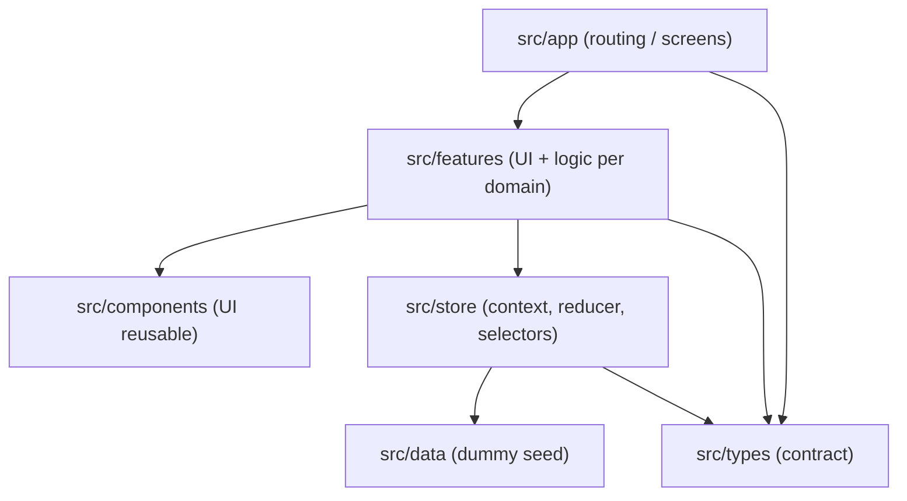
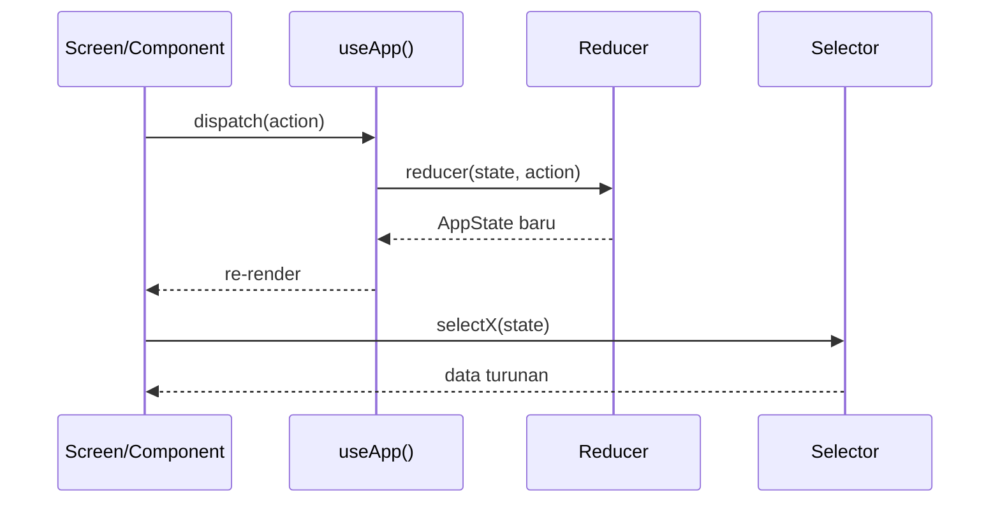

# Arsitektur Aplikasi

Dokumen ini menjelaskan struktur teknis, pembagian layer, routing, dan pengelolaan state. Semua programmer wajib mengikuti struktur ini agar pekerjaan tiga orang tidak saling bertabrakan.

---

## 1. Prinsip Utama

1. **Contract-first** — tipe data, aksi, dan selector disepakati lebih dulu.
2. **Feature-based** — kode dikelompokkan berdasarkan domain (jadwal, sesi, presensi, rekap), bukan berdasarkan tipe file.
3. **Route tipis** — `src/app/**` hanya membaca parameter dan merender komponen fitur.
4. **Single source of truth** — seluruh data aplikasi hidup di satu `AppState`.
5. **Derived data** — jumlah hadir, status kehadiran, dan join antar entity dihitung di selector, tidak disimpan di state.
6. **Immutability** — reducer selalu mengembalikan objek/array baru.

---

## 2. Layer



- **app** — hanya route, layout, dan pemanggilan komponen fitur.
- **features** — komponen layar, form, bottom sheet, dan logika presentasi per domain.
- **components** — primitif UI dan komponen domain yang dipakai lintas fitur.
- **store** — `AppProvider`, reducer, aksi, dan selector.
- **data** — data dummy awal.
- **types** — kontrak TypeScript.
- **utils** — helper format tanggal/waktu.

---

## 3. Struktur Folder

```text
src/
├─ app/                              # route expo-router (tipis)
│  ├─ _layout.tsx                    # [D1] AppProvider + Stack
│  ├─ index.tsx                      # [D1] form pilih peran & identitas
│  ├─ (tabs)/
│  │  ├─ _layout.tsx                 # [D1] Tabs, tab berbeda per peran
│  │  ├─ jadwal.tsx                  # [D2] daftar jadwal
│  │  ├─ kehadiran.tsx               # [D2] riwayat praktikan
│  │  ├─ rekap.tsx                   # [D3] daftar rekap asisten
│  │  └─ profil.tsx                  # [D1] profil / ganti pengguna
│  └─ sesi/
│     └─ [sesiId].tsx                # [D1] orkestrator detail sesi
├─ components/
│  ├─ ui/                            # [D1] primitif UI
│  │  ├─ ScreenContainer.tsx
│  │  ├─ AppCard.tsx
│  │  ├─ AppButton.tsx
│  │  ├─ StatusBadge.tsx
│  │  ├─ EmptyState.tsx
│  │  ├─ SectionHeader.tsx
│  │  ├─ InfoBanner.tsx
│  │  ├─ ConfirmSheet.tsx
│  │  ├─ FormField.tsx
│  │  └─ RadioOption.tsx
│  └─ domain/
│     ├─ SessionCard.tsx             # [D2] kartu sesi untuk jadwal & rekap
│     └─ AttendanceRow.tsx           # [D3] baris rekap kehadiran
├─ features/
│  ├─ sesi/
│  │  ├─ SessionDetailScreen.tsx     # [D1] orkestrator, pilih view berdasarkan peran
│  │  ├─ praktikan/
│  │  │  ├─ PraktikanSessionView.tsx # [D2]
│  │  │  ├─ PresensiForm.tsx         # [D2]
│  │  │  └─ PresensiSuccess.tsx      # [D2]
│  │  └─ asisten/
│  │     ├─ AsistenSessionView.tsx   # [D3]
│  │     └─ SessionControlCard.tsx   # [D3]
│  ├─ jadwal/
│  │  └─ JadwalScreen.tsx            # [D2]
│  ├─ kehadiran/
│  │  └─ KehadiranScreen.tsx         # [D2]
│  └─ rekap/
│     ├─ RekapScreen.tsx             # [D3]
│     └─ RekapSummary.tsx            # [D3]
├─ data/
│  └─ dummy.ts                       # [D1]
├─ store/
│  ├─ app-context.tsx                # [D1] provider + reducer + useApp
│  └─ selectors.ts                   # [D1]
├─ constants/
│  └─ theme.ts                       # [D1] token warna, spacing, radius
├─ types/
│  └─ models.ts                      # [D1] kontrak data
└─ utils/
   └─ date.ts                        # [D1]
```

Penanda `[D1]`, `[D2]`, `[D3]` adalah pemilik file. Jangan mengedit file milik dev lain tanpa koordinasi.

---

## 4. Routing

Expo Router memakai file-based routing. Struktur yang dipakai:

| URL | File | Peran | Keterangan |
| --- | --- | --- | --- |
| `/` | `src/app/index.tsx` | semua | Form pilih peran & identitas |
| `/jadwal` | `src/app/(tabs)/jadwal.tsx` | semua | Tab jadwal |
| `/kehadiran` | `src/app/(tabs)/kehadiran.tsx` | praktikan | Tab riwayat |
| `/rekap` | `src/app/(tabs)/rekap.tsx` | asisten | Tab rekap |
| `/profil` | `src/app/(tabs)/profil.tsx` | semua | Tab profil |
| `/sesi/[sesiId]` | `src/app/sesi/[sesiId].tsx` | semua | Detail sesi, di luar tab agar tab bar tersembunyi |

### Root layout

```tsx
// src/app/_layout.tsx
import { Stack } from 'expo-router';
import { AppProvider } from '@/store/app-context';

export default function RootLayout() {
  return (
    <AppProvider>
      <Stack screenOptions={{ headerShown: false }}>
        <Stack.Screen name="index" />
        <Stack.Screen name="(tabs)" />
        <Stack.Screen
          name="sesi/[sesiId]"
          options={{ headerShown: true, title: 'Detail Sesi' }}
        />
      </Stack>
    </AppProvider>
  );
}
```

### Tabs per peran

Satu layout tabs, tetapi tab yang ditampilkan bergantung pada `currentUser.peran`. Gunakan `href: null` untuk menyembunyikan route yang tidak relevan.

```tsx
// src/app/(tabs)/_layout.tsx
import { Redirect, Tabs } from 'expo-router';
import { useApp } from '@/store/app-context';

export default function TabsLayout() {
  const { state } = useApp();
  if (!state.currentUser) return <Redirect href="/" />;

  const isAsisten = state.currentUser.peran === 'asisten';

  return (
    <Tabs>
      <Tabs.Screen name="jadwal" options={{ title: 'Jadwal' }} />
      <Tabs.Screen
        name="rekap"
        options={{ title: 'Rekap', href: isAsisten ? undefined : null }}
      />
      <Tabs.Screen
        name="kehadiran"
        options={{ title: 'Kehadiran', href: isAsisten ? null : undefined }}
      />
      <Tabs.Screen name="profil" options={{ title: 'Profil' }} />
    </Tabs>
  );
}
```

### Guard

- `(tabs)/_layout.tsx` → redirect ke `/` jika belum ada user.
- `kehadiran.tsx` → redirect ke `/jadwal` jika user adalah asisten.
- `rekap.tsx` → redirect ke `/jadwal` jika user adalah praktikan.
- `sesi/[sesiId].tsx` → redirect ke `/` jika belum ada user; tampilkan state “Sesi tidak ditemukan” jika id tidak ada.
- Jangan mengandalkan guard saja untuk aturan bisnis. Guard UI hanya untuk navigasi; aturan presensi tetap divalidasi di reducer.

---

## 5. State Management

Memakai **React Context + useReducer**. Tidak perlu Redux/Zustand untuk scope sprint ini.

### Kenapa Context + useReducer

- State kecil dan hanya satu sumber.
- Aksi terpusat sehingga aturan bisnis mudah diaudit.
- Tanpa dependency tambahan.
- Mudah diuji secara manual dan deterministic.

### Alur state



### Aturan state

1. Semua entity (`pengguna`, `praktikum`, `kelas`, `sesi`, `presensi`) berada di `AppState`.
2. `currentUser` hanya menunjuk ke salah satu entity di `pengguna`.
3. State form lokal (input catatan, checkbox, visibilitas modal) boleh memakai `useState` di komponen.
4. Data turunan tidak boleh disimpan di state: hitung lewat selector.
5. Reducer tidak boleh melakukan I/O, `console.log`, atau memanggil `Date.now()` di luar payload aksi. Waktu presensi dikirim lewat payload agar mudah diuji.
6. Reducer mengembalikan `state` yang sama jika aksi tidak valid (no-op), bukan melempar error.

---

## 6. Data Flow per Fitur

### Membuka sesi

```text
Asisten menekan "Buka Sesi"
  → ConfirmSheet
  → dispatch({ type: 'BUKA_SESI', sesiId })
  → reducer mengubah status sesi menjadi 'dibuka'
  → semua layar yang membaca sesi re-render
  → StatusBadge di jadwal & detail berubah
```

### Presensi

```text
Praktikan mengisi catatan + checkbox
  → tekan "Konfirmasi Presensi"
  → ConfirmSheet
  → dispatch({ type: 'CATAT_PRESENSI', sesiId, praktikanId, catatan, waktuPresensi })
  → reducer memvalidasi status sesi, kelas, dan duplikasi
  → record presensi ditambahkan
  → detail menampilkan waktu kehadiran
  → riwayat praktikan dan rekap asisten ikut berubah
```

### Menutup sesi

```text
Asisten menekan "Tutup Sesi"
  → ConfirmSheet peringatan
  → dispatch({ type: 'TUTUP_SESI', sesiId })
  → status menjadi 'ditutup'
  → form presensi praktikan tidak lagi tampil
  → rekap tetap dapat dibaca
```

---

## 7. Styling dan Layout

- Gunakan `StyleSheet.create`, bukan inline style untuk style statis.
- Token warna, spacing, radius, dan font berada di `src/constants/theme.ts`.
- Gunakan Flexbox:
  - baris: `flexDirection: 'row'`, `alignItems: 'center'`, `gap`.
  - teks panjang: `flexShrink: 1`, `numberOfLines`.
  - tombol aksi: `alignSelf: 'stretch'` pada mobile.
- Konten dibatasi `maxWidth: 800` dan `alignSelf: 'center'` agar nyaman di tablet/web.
- Gunakan `FlatList` untuk daftar jadwal, rekap, dan riwayat.
- Gunakan `KeyboardAvoidingView` + `ScrollView` pada layar yang memiliki input.
- Gunakan `react-native-safe-area-context` untuk area aman.

---

## 8. Dependency

Untuk sprint ini **tidak perlu menambah runtime dependency**. Yang sudah tersedia:

- `expo-router` untuk navigasi.
- `react-native-safe-area-context` untuk safe area.
- `expo-symbols` / ikon teks untuk tab (opsional).
- `Intl` bawaan JavaScript untuk format tanggal.

Jika benar-benar perlu ikon tab, install dengan cara Expo:

```bash
npx expo install @expo/vector-icons
```

Jangan memakai `npm install` biasa untuk paket Expo/native.

---

## 9. Keputusan Teknis

| Keputusan | Pilihan | Alasan |
| --- | --- | --- |
| State | Context + useReducer | Scope kecil, tanpa dependency, mudah diaudit |
| Routing | Expo Router | Sudah dipakai template, file-based, mendukung tabs + stack |
| Detail sesi | Route di luar tabs | Tab bar tidak mengganggu layar detail |
| Modal | `Modal` transparan bergaya bottom sheet | Tidak perlu library tambahan |
| Data | Dummy di `src/data/dummy.ts` | Sprint belum menyentuh backend |
| Persistensi | Tidak ada | Cukup state selama aplikasi berjalan |
| Waktu | ISO string + `Intl` `id-ID` | Tidak perlu library tanggal |
| Bahasa UI | Indonesia, sapaan “kamu” | Konsisten dan ramah untuk praktikan |

---

## 10. Risiko dan Mitigasi

| Risiko | Mitigasi |
| --- | --- |
| Tiga orang mengedit file yang sama | Patuhi peta kepemilikan file; koordinasi sebelum menyentuh file bersama |
| Kontrak tipe berubah di tengah jalan | Perubahan `models.ts` / `app-context.tsx` harus lewat PR Dev 1 dan diumumkan |
| Status sesi tidak konsisten antar layar | Semua layar membaca `state.sesi`; jangan menyimpan salinan status di local state |
| Presensi ganda | Validasi di reducer + UI menyembunyikan form setelah presensi |
| Layout berantakan di HP kecil | Uji lebar 320 px; gunakan `flexShrink`, `numberOfLines`, dan `ScrollView` |
| Data demo habis / kacau saat presentasi | Reload aplikasi atau gunakan aksi `RESET_DATA` (opsional) |
| Bug hanya muncul saat ganti peran | Uji alur penuh dengan berganti peran, bukan hanya satu peran |

---

## 11. Larangan

- Jangan menambah Redux, Zustand, React Query, Axios, atau ORM.
- Jangan memakai `AsyncStorage` atau database lokal.
- Jangan melakukan mutasi langsung ke `state` (mis. `state.sesi[0].status = ...`).
- Jangan menaruh logika bisnis di file route `src/app/**`.
- Jangan membuat komponen UI baru di dalam file layar jika komponen tersebut dipakai lebih dari satu layar; taruh di `components/`.
- Jangan mengubah `app.json`, `eas.json`, atau konfigurasi native tanpa koordinasi.
