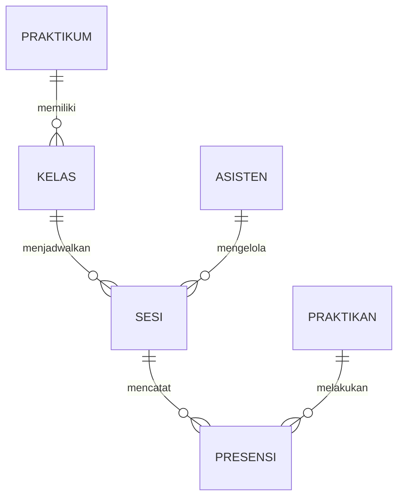

# Data Model, State, dan Aturan Bisnis

Semua kode di dokumen ini adalah **kontrak**. Dev 2 dan Dev 3 boleh mengimpor tipe, aksi, dan selector, tetapi tidak boleh mengubah definisinya tanpa koordinasi Dev 1.

---

## 1. Entity Relationship



- Satu praktikum punya banyak kelas.
- Satu kelas punya banyak sesi.
- Satu sesi punya banyak presensi.
- Satu praktikan punya banyak presensi.
- Untuk sprint ini, satu sesi diasosiasikan ke satu asisten.

---

## 2. TypeScript Types

```ts
// src/types/models.ts

export type Peran = 'praktikan' | 'asisten';

export type StatusSesi = 'dijadwalkan' | 'dibuka' | 'ditutup';

export interface Praktikan {
  id: string;
  peran: 'praktikan';
  nama: string;
  nim: string;
  kelasId: string;
}

export interface Asisten {
  id: string;
  peran: 'asisten';
  nama: string;
  nip: string;
}

export type Pengguna = Praktikan | Asisten;

export interface Praktikum {
  id: string;
  nama: string;
  kode: string;
}

export interface Kelas {
  id: string;
  nama: string;
  praktikumId: string;
}

export interface Sesi {
  id: string;
  praktikumId: string;
  kelasId: string;
  asistenId: string;
  topik: string;
  ruang: string;
  /** Format YYYY-MM-DD, memakai tanggal lokal perangkat. */
  tanggal: string;
  /** Format HH:mm, 24 jam. */
  jamMulai: string;
  /** Format HH:mm, 24 jam. */
  jamSelesai: string;
  status: StatusSesi;
}

export interface Presensi {
  id: string;
  sesiId: string;
  praktikanId: string;
  /** ISO 8601, waktu lokal perangkat saat presensi dicatat. */
  waktuPresensi: string;
  catatan?: string;
}

export interface AppState {
  currentUser: Pengguna | null;
  pengguna: Pengguna[];
  praktikum: Praktikum[];
  kelas: Kelas[];
  sesi: Sesi[];
  presensi: Presensi[];
}
```

### Label status

```ts
export const LABEL_STATUS: Record<StatusSesi, string> = {
  dijadwalkan: 'Dijadwalkan',
  dibuka: 'Dibuka',
  ditutup: 'Ditutup',
};
```

---

## 3. State Awal

```ts
export const initialState: AppState = {
  currentUser: null,
  pengguna: dataPengguna,
  praktikum: dataPraktikum,
  kelas: dataKelas,
  sesi: dataSesi,
  presensi: dataPresensi,
};
```

`initialState` dibuat sekali saat modul dimuat. Reload aplikasi = data kembali ke kondisi awal.

---

## 4. Aksi (Reducer)

```ts
export type AppAction =
  | { type: 'PILIH_PENGGUNA'; pengguna: Pengguna }
  | { type: 'KELUAR' }
  | { type: 'BUKA_SESI'; sesiId: string }
  | { type: 'TUTUP_SESI'; sesiId: string }
  | {
      type: 'CATAT_PRESENSI';
      sesiId: string;
      praktikanId: string;
      catatan?: string;
      /** Opsional agar reducer mudah diuji; default new Date().toISOString(). */
      waktuPresensi?: string;
    }
  | { type: 'RESET_DATA' };
```

| Aksi | Efek | Guard / aturan |
| --- | --- | --- |
| `PILIH_PENGGUNA` | set `currentUser` | `pengguna` harus ada di `state.pengguna` |
| `KELUAR` | `currentUser = null` | — |
| `BUKA_SESI` | status sesi → `dibuka` | hanya dari `dijadwalkan` |
| `TUTUP_SESI` | status sesi → `ditutup` | hanya dari `dibuka` |
| `CATAT_PRESENSI` | tambah record presensi | sesi harus `dibuka`; praktikan harus ada, berperan praktikan, dan `kelasId` sama dengan sesi; belum ada record untuk `sesiId + praktikanId` |
| `RESET_DATA` | kembali ke `initialState` | `currentUser` menjadi `null` |

Aksi yang tidak valid **tidak melempar error**; reducer mengembalikan `state` yang sama.

---

## 5. Aturan Bisnis

### Status sesi

```text
dijadwalkan ──BUKA_SESI──▶ dibuka ──TUTUP_SESI──▶ ditutup
```

- Tidak ada transisi balik dari `ditutup`.
- Asisten hanya melihat tombol **Buka Sesi** saat `dijadwalkan`.
- Asisten hanya melihat tombol **Tutup Sesi** saat `dibuka`.
- Saat `ditutup`, tidak ada tombol perubahan status.

### Presensi

1. Hanya untuk `currentUser.peran === 'praktikan'`.
2. Hanya jika `sesi.status === 'dibuka'`.
3. Hanya jika `praktikan.kelasId === sesi.kelasId`.
4. Satu record per kombinasi `sesiId + praktikanId`.
5. `waktuPresensi` diisi saat aksi dikirim (bukan saat render).
6. `catatan` di-trim; string kosong disimpan sebagai `undefined`.

### Rekap

- Hanya record presensi milik sesi tersebut.
- Urutkan berdasarkan `waktuPresensi` naik (paling awal di atas).
- `totalPraktikan` = jumlah pengguna berperan praktikan dengan `kelasId` sama dengan sesi.
- `jumlahHadir` = jumlah record presensi sesi tersebut.

### Riwayat praktikan

Status per sesi untuk praktikan:

| Kondisi | Status tampilan |
| --- | --- |
| Ada record presensi | `hadir` |
| Tidak ada record, sesi `dibuka` | `belum-presensi` |
| Tidak ada record, sesi `dijadwalkan` | `belum-berlangsung` |
| Tidak ada record, sesi `ditutup` | `tidak-hadir` |

---

## 6. Selector

Semua selector adalah fungsi murni `(state, ...args) => data`. Letakkan di `src/store/selectors.ts`.

| Selector | Signature | Kegunaan |
| --- | --- | --- |
| `selectCurrentUser` | `(state) => Pengguna \| null` | user aktif |
| `selectSesiById` | `(state, sesiId) => Sesi \| null` | cari sesi |
| `selectSesiUntukPengguna` | `(state) => Sesi[]` | sesi yang terlihat oleh user aktif |
| `selectDetailSesi` | `(state, sesiId) => DetailSesi \| null` | join sesi + praktikum + kelas + asisten + rekap + presensi saya |
| `selectRekapSesi` | `(state, sesiId) => RekapSesi` | daftar hadir + hitungan |
| `selectRiwayatPraktikan` | `(state, praktikanId) => RiwayatItem[]` | riwayat sesi praktikan |
| `selectJumlahHadir` | `(state, sesiId) => number` | jumlah hadir |
| `selectTotalPraktikan` | `(state, kelasId) => number` | total praktikan kelas |
| `selectSudahPresensi` | `(state, sesiId, praktikanId) => boolean` | cek duplikasi |

### Tipe hasil selector

```ts
export interface BarisRekap {
  presensi: Presensi;
  praktikan: Praktikan;
}

export interface RekapSesi {
  baris: BarisRekap[];
  jumlahHadir: number;
  totalPraktikan: number;
}

export type StatusKehadiran =
  | 'hadir'
  | 'belum-presensi'
  | 'belum-berlangsung'
  | 'tidak-hadir';

export interface RiwayatItem {
  sesi: Sesi;
  presensi: Presensi | null;
  status: StatusKehadiran;
}

export interface DetailSesi {
  sesi: Sesi;
  praktikum: Praktikum;
  kelas: Kelas;
  asisten: Asisten;
  presensiSaya: Presensi | null;
  rekap: RekapSesi;
}
```

### Aturan filter dan sorting

`selectSesiUntukPengguna`:

- Asisten → semua sesi.
- Praktikan → hanya sesi dengan `kelasId === praktikan.kelasId`.
- Urutkan dengan prioritas status: `dibuka` → `dijadwalkan` → `ditutup`.
- Di dalam status yang sama: `dijadwalkan` dan `dibuka` urut tanggal/jam naik; `ditutup` urut tanggal/jam turun.

```ts
const prioritas: Record<StatusSesi, number> = {
  dibuka: 0,
  dijadwalkan: 1,
  ditutup: 2,
};
```

---

## 7. Dummy Data

### Pengguna

| id | peran | nama | NIM/NIP | kelas |
| --- | --- | --- | --- | --- |
| `asisten-1` | asisten | Nauval | 1987654321 | — |
| `praktikan-1` | praktikan | Budi Santoso | 2310511001 | `kelas-a` |
| `praktikan-2` | praktikan | Siti Rahma | 2310511002 | `kelas-a` |
| `praktikan-3` | praktikan | Rizky Pratama | 2310511003 | `kelas-b` |
| `praktikan-4` | praktikan | Dewi Lestari | 2310511004 | `kelas-c` |

### Praktikum dan kelas

| id | nama | kode |
| --- | --- | --- |
| `praktikum-ppk` | Praktikum Pemrograman Komputer | PPK |

| id | nama | praktikumId |
| --- | --- | --- |
| `kelas-a` | PPK A | `praktikum-ppk` |
| `kelas-b` | PPK B | `praktikum-ppk` |
| `kelas-c` | PPK C | `praktikum-ppk` |

### Sesi

Tanggal dibuat relatif terhadap hari ini agar demo selalu relevan.

| id | kelas | topik | offset hari | jam | ruang | status awal | asisten |
| --- | --- | --- | --- | --- | --- | --- | --- |
| `sesi-1` | `kelas-a` | Pengenalan React Native | -7 | 10:00–12:00 | Lab 3 | `ditutup` | `asisten-1` |
| `sesi-2` | `kelas-a` | Komponen & Layout | 0 | 10:00–12:00 | Lab 3 | `dijadwalkan` | `asisten-1` |
| `sesi-3` | `kelas-a` | State & Navigasi | +7 | 10:00–12:00 | Lab 3 | `dijadwalkan` | `asisten-1` |
| `sesi-4` | `kelas-b` | Pengenalan React Native | -6 | 13:00–15:00 | Lab 5 | `ditutup` | `asisten-1` |
| `sesi-5` | `kelas-b` | Komponen & Layout | +8 | 13:00–15:00 | Lab 5 | `dijadwalkan` | `asisten-1` |

### Presensi awal

| id | sesi | praktikan | waktu | catatan |
| --- | --- | --- | --- | --- |
| `pres-sesi-1-praktikan-1` | `sesi-1` | `praktikan-1` | offset -7, 10:04 | — |
| `pres-sesi-1-praktikan-2` | `sesi-1` | `praktikan-2` | offset -7, 10:12 | — |
| `pres-sesi-4-praktikan-3` | `sesi-4` | `praktikan-3` | offset -6, 13:05 | Hadir di Lab 5 |

Kondisi awal yang penting untuk demo:

- `sesi-2` (kelas A, hari ini) masih `dijadwalkan`, sehingga asisten bisa mendemokan **Buka Sesi**.
- `sesi-1` sudah `ditutup` dan punya 2 presensi, sehingga riwayat praktikan langsung berisi data.
- `sesi-4` memberi riwayat untuk Rizky di kelas B.
- Rekap `sesi-2` awalnya kosong (`0/2`) untuk mendemokan empty state.
- `kelas-c` sengaja tidak memiliki sesi. Praktikan **Dewi Lestari** dipakai untuk menguji empty state jadwal dan riwayat.

### Skeleton `src/data/dummy.ts`

```ts
import type {
  AppState,
  Asisten,
  Kelas,
  Praktikan,
  Praktikum,
  Presensi,
  Sesi,
} from '@/types/models';

function tanggalRelatif(offsetHari: number): string {
  const d = new Date();
  d.setDate(d.getDate() + offsetHari);
  const yyyy = d.getFullYear();
  const mm = String(d.getMonth() + 1).padStart(2, '0');
  const dd = String(d.getDate()).padStart(2, '0');
  return `${yyyy}-${mm}-${dd}`;
}

function waktuRelatif(offsetHari: number, jam: number, menit: number): string {
  const d = new Date();
  d.setDate(d.getDate() + offsetHari);
  d.setHours(jam, menit, 0, 0);
  return d.toISOString();
}

const asisten: Asisten = {
  id: 'asisten-1',
  peran: 'asisten',
  nama: 'Nauval',
  nip: '1987654321',
};

const praktikan: Praktikan[] = [
  {
    id: 'praktikan-1',
    peran: 'praktikan',
    nama: 'Budi Santoso',
    nim: '2310511001',
    kelasId: 'kelas-a',
  },
  {
    id: 'praktikan-2',
    peran: 'praktikan',
    nama: 'Siti Rahma',
    nim: '2310511002',
    kelasId: 'kelas-a',
  },
  {
    id: 'praktikan-3',
    peran: 'praktikan',
    nama: 'Rizky Pratama',
    nim: '2310511003',
    kelasId: 'kelas-b',
  },
  {
    id: 'praktikan-4',
    peran: 'praktikan',
    nama: 'Dewi Lestari',
    nim: '2310511004',
    kelasId: 'kelas-c',
  },
];

const praktikum: Praktikum[] = [
  {
    id: 'praktikum-ppk',
    nama: 'Praktikum Pemrograman Komputer',
    kode: 'PPK',
  },
];

const kelas: Kelas[] = [
  { id: 'kelas-a', nama: 'PPK A', praktikumId: 'praktikum-ppk' },
  { id: 'kelas-b', nama: 'PPK B', praktikumId: 'praktikum-ppk' },
  { id: 'kelas-c', nama: 'PPK C', praktikumId: 'praktikum-ppk' },
];

const sesi: Sesi[] = [
  {
    id: 'sesi-1',
    praktikumId: 'praktikum-ppk',
    kelasId: 'kelas-a',
    asistenId: 'asisten-1',
    topik: 'Pengenalan React Native',
    ruang: 'Lab 3',
    tanggal: tanggalRelatif(-7),
    jamMulai: '10:00',
    jamSelesai: '12:00',
    status: 'ditutup',
  },
  {
    id: 'sesi-2',
    praktikumId: 'praktikum-ppk',
    kelasId: 'kelas-a',
    asistenId: 'asisten-1',
    topik: 'Komponen & Layout',
    ruang: 'Lab 3',
    tanggal: tanggalRelatif(0),
    jamMulai: '10:00',
    jamSelesai: '12:00',
    status: 'dijadwalkan',
  },
  // sesi-3, sesi-4, sesi-5 mengikuti pola yang sama
];

const presensi: Presensi[] = [
  {
    id: 'pres-sesi-1-praktikan-1',
    sesiId: 'sesi-1',
    praktikanId: 'praktikan-1',
    waktuPresensi: waktuRelatif(-7, 10, 4),
  },
  {
    id: 'pres-sesi-1-praktikan-2',
    sesiId: 'sesi-1',
    praktikanId: 'praktikan-2',
    waktuPresensi: waktuRelatif(-7, 10, 12),
  },
  {
    id: 'pres-sesi-4-praktikan-3',
    sesiId: 'sesi-4',
    praktikanId: 'praktikan-3',
    waktuPresensi: waktuRelatif(-6, 13, 5),
    catatan: 'Hadir di Lab 5',
  },
];

export const initialState: AppState = {
  currentUser: null,
  pengguna: [asisten, ...praktikan],
  praktikum,
  kelas,
  sesi,
  presensi,
};
```

---

## 8. Contoh Implementasi Reducer

```ts
function appReducer(state: AppState, action: AppAction): AppState {
  switch (action.type) {
    case 'PILIH_PENGGUNA': {
      const ada = state.pengguna.some((u) => u.id === action.pengguna.id);
      return ada ? { ...state, currentUser: action.pengguna } : state;
    }

    case 'KELUAR':
      return { ...state, currentUser: null };

    case 'BUKA_SESI': {
      const sesi = state.sesi.find((s) => s.id === action.sesiId);
      if (!sesi || sesi.status !== 'dijadwalkan') return state;
      return {
        ...state,
        sesi: state.sesi.map((s) =>
          s.id === action.sesiId ? { ...s, status: 'dibuka' } : s,
        ),
      };
    }

    case 'TUTUP_SESI': {
      const sesi = state.sesi.find((s) => s.id === action.sesiId);
      if (!sesi || sesi.status !== 'dibuka') return state;
      return {
        ...state,
        sesi: state.sesi.map((s) =>
          s.id === action.sesiId ? { ...s, status: 'ditutup' } : s,
        ),
      };
    }

    case 'CATAT_PRESENSI': {
      const sesi = state.sesi.find((s) => s.id === action.sesiId);
      if (!sesi || sesi.status !== 'dibuka') return state;

      const praktikan = state.pengguna.find(
        (u) => u.id === action.praktikanId,
      );
      if (
        !praktikan ||
        praktikan.peran !== 'praktikan' ||
        praktikan.kelasId !== sesi.kelasId
      ) {
        return state;
      }

      const sudah = state.presensi.some(
        (p) =>
          p.sesiId === action.sesiId &&
          p.praktikanId === action.praktikanId,
      );
      if (sudah) return state;

      const baru: Presensi = {
        id: `pres-${action.sesiId}-${action.praktikanId}`,
        sesiId: action.sesiId,
        praktikanId: action.praktikanId,
        waktuPresensi:
          action.waktuPresensi ?? new Date().toISOString(),
        catatan: action.catatan?.trim() || undefined,
      };

      return { ...state, presensi: [...state.presensi, baru] };
    }

    case 'RESET_DATA':
      return initialState;

    default:
      return state;
  }
}
```

---

## 9. Helper Tanggal

```ts
// src/utils/date.ts

export function formatTanggal(tanggal: string): string {
  return new Intl.DateTimeFormat('id-ID', {
    weekday: 'long',
    day: 'numeric',
    month: 'long',
    year: 'numeric',
  }).format(new Date(`${tanggal}T00:00:00`));
}

export function formatJam(jam: string): string {
  return jam.replace(':', '.');
}

export function formatWaktuPresensi(iso: string): string {
  return new Intl.DateTimeFormat('id-ID', {
    hour: '2-digit',
    minute: '2-digit',
    hourCycle: 'h23',
  })
    .format(new Date(iso))
    .replace(':', '.');
}
```

Contoh tampilan: `Rabu, 21 Oktober 2026`, `10.00–12.00`, `10.04`.

---

## 10. Checklist Kontrak

- [ ] `models.ts` berisi semua tipe di atas.
- [ ] `dummy.ts` menghasilkan 5 pengguna (1 asisten + 4 praktikan), 3 kelas, 5 sesi, dan 3 presensi awal.
- [ ] `app-context.tsx` menyediakan `AppProvider` dan hook `useApp()`.
- [ ] `useApp()` mengembalikan `{ state, dispatch }`.
- [ ] Semua aksi dan guard diimplementasikan.
- [ ] Selector mengembalikan data baru (tidak memutasi state).
- [ ] `initialState` bisa dipakai ulang oleh `RESET_DATA`.
- [ ] Tidak ada `any` yang tidak perlu.
