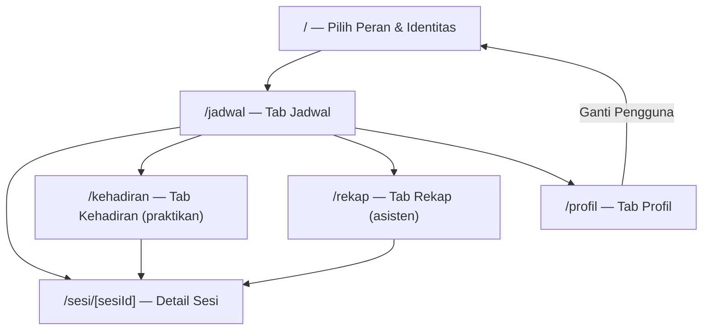

# Navigasi, Layar, dan Spesifikasi UI

Dokumen ini menjadi acuan Dev 2 dan Dev 3 saat membangun layar. Semua ukuran memakai token di `src/constants/theme.ts`, bukan angka acak.

---

## 1. Peta Navigasi



| Route | File | Tab yang terlihat | Guard |
| --- | --- | --- | --- |
| `/` | `src/app/index.tsx` | — | jika sudah ada user, tetap boleh memilih ulang |
| `/jadwal` | `src/app/(tabs)/jadwal.tsx` | Jadwal | harus ada user |
| `/kehadiran` | `src/app/(tabs)/kehadiran.tsx` | Kehadiran | hanya praktikan |
| `/rekap` | `src/app/(tabs)/rekap.tsx` | Rekap | hanya asisten |
| `/profil` | `src/app/(tabs)/profil.tsx` | Profil | harus ada user |
| `/sesi/[sesiId]` | `src/app/sesi/[sesiId].tsx` | — | harus ada user; sesi harus ada |

Tab per peran:

| Peran | Tab 1 | Tab 2 | Tab 3 |
| --- | --- | --- | --- |
| Praktikan | Jadwal | Kehadiran | Profil |
| Asisten | Jadwal | Rekap | Profil |

---

## 2. Design Token

Letakkan di `src/constants/theme.ts`.

```ts
export const Colors = {
  background: '#F7F8FA',
  surface: '#FFFFFF',
  text: '#101828',
  textMuted: '#667085',
  border: '#E4E7EC',
  primary: '#1A56DB',
  primaryPressed: '#1546B5',
  primarySoft: '#E8F0FE',
  success: '#067647',
  successSoft: '#E6F9EE',
  warning: '#B54708',
  warningSoft: '#FEF0C7',
  danger: '#D92D20',
  dangerSoft: '#FEE4E2',
  neutralSoft: '#F2F4F7',
} as const;

export const Spacing = {
  xs: 4,
  sm: 8,
  md: 16,
  lg: 24,
  xl: 32,
} as const;

export const Radius = {
  sm: 8,
  md: 12,
  lg: 16,
  pill: 999,
} as const;

export const FontSize = {
  xs: 12,
  sm: 14,
  md: 16,
  lg: 20,
  xl: 24,
} as const;
```

### Warna status

| Status | Background | Text |
| --- | --- | --- |
| `dijadwalkan` | `#E8F0FE` | `#1A56DB` |
| `dibuka` | `#E6F9EE` | `#067647` |
| `ditutup` | `#F2F4F7` | `#475467` |

Jangan menyampaikan status hanya lewat warna. Selalu sertakan label teks.

---

## 3. Komponen UI

| Komponen | Tanggung jawab | Pemilik |
| --- | --- | --- |
| `ScreenContainer` | Safe area, background, padding, max width 800 | D1 |
| `AppCard` | Surface, border, radius, padding | D1 |
| `AppButton` | Varian `primary`, `secondary`, `danger`, `ghost`; state disabled | D1 |
| `StatusBadge` | Label + warna status sesi | D1 |
| `EmptyState` | Judul, deskripsi, aksi opsional | D1 |
| `SectionHeader` | Judul section + teks kanan opsional | D1 |
| `InfoBanner` | Tone `info`, `success`, `warning`, `danger` | D1 |
| `ConfirmSheet` | Bottom sheet konfirmasi dengan judul, isi, batal, aksi | D1 |
| `FormField` | Label, input, helper/error | D1 |
| `RadioOption` | Pilihan identitas/peran | D1 |
| `SessionCard` | Kartu sesi untuk jadwal & rekap | D2 |
| `AttendanceRow` | Baris nama + NIM + waktu + badge hadir | D3 |

### Kontrak `ConfirmSheet`

```tsx
interface ConfirmSheetProps {
  visible: boolean;
  title: string;
  description?: string;
  confirmLabel: string;
  cancelLabel?: string; // default "Batal"
  tone?: 'primary' | 'danger';
  onConfirm: () => void;
  onClose: () => void;
}
```

### Kontrak `SessionCard`

```tsx
interface SessionCardProps {
  praktikum: string;
  kelas: string;
  topik: string;
  tanggal: string;   // sudah diformat
  waktu: string;     // "10.00–12.00"
  ruang: string;
  status: StatusSesi;
  meta?: string;     // "1/2 hadir" atau "Hadir · 10.04"
  metaTone?: 'default' | 'success' | 'warning' | 'danger';
  onPress: () => void;
}
```

### Kontrak `AttendanceRow`

```tsx
interface AttendanceRowProps {
  nama: string;
  nim: string;
  waktu: string; // sudah diformat, mis. "10.04"
}
```

---

## 4. Layar 1 — Pilih Peran & Identitas (`/`)

**Tujuan:** memilih peran dan identitas dummy sebelum masuk.

**Data:** `state.pengguna`, dikelompokkan berdasarkan `peran`.

**Layout:**

```text
┌──────────────────────────────────┐
│  Presensi Praktikum              │
│  Pilih peran dan identitas       │
│                                  │
│  Peran                           │
│  ┌────────────┐ ┌─────────────┐  │
│  │ Praktikan  │ │  Asisten    │  │
│  └────────────┘ └─────────────┘  │
│                                  │
│  Identitas                       │
│  (•) Budi Santoso                │
│      2310511001 · PPK A          │
│  ( ) Siti Rahma                  │
│      2310511002 · PPK A          │
│                                  │
│  [          Masuk          ]     │
└──────────────────────────────────┘
```

**Perilaku:**

- Default peran: `praktikan`.
- Ganti peran → reset pilihan identitas.
- Daftar identitas difilter sesuai peran.
- Tombol **Masuk** disabled sampai identitas dipilih.
- Tekan **Masuk** → `dispatch({ type: 'PILIH_PENGGUNA', pengguna })` → `router.replace('/jadwal')`.
- Ini adalah **form** yang memenuhi kebutuhan input/pilihan pengguna.

**State:**

- Belum pilih identitas → helper text “Pilih identitas terlebih dahulu.”
- Tidak ada pengguna untuk peran tersebut → empty state kecil.

---

## 5. Layar 2 — Jadwal (`/jadwal`)

**Tujuan:** daftar sesi yang relevan untuk user aktif.

**Data:** `selectSesiUntukPengguna(state)`, `selectDetailSesi` atau selector gabungan untuk meta.

**Layout:**

```text
┌──────────────────────────────────┐
│ Jadwal                           │
│ Praktikum Pemrograman Komputer   │
│                                  │
│ ┌──────────────────────────────┐ │
│ │ PPK A              [DIBUKA]  │ │
│ │ Komponen & Layout            │ │
│ │ Rabu, 21 Okt · 10.00–12.00   │ │
│ │ Lab 3                        │ │
│ │ 1/2 hadir                    │ │
│ └──────────────────────────────┘ │
│ ┌──────────────────────────────┐ │
│ │ PPK A          [DIJADWALKAN] │ │
│ │ State & Navigasi             │ │
│ │ Rabu, 28 Okt · 10.00–12.00   │ │
│ │ Lab 3                        │ │
│ │ Belum berlangsung            │ │
│ └──────────────────────────────┘ │
└──────────────────────────────────┘
```

**Perilaku:**

- Kartu bisa ditekan → `router.push(`/sesi/${sesi.id}`)`.
- Asisten melihat semua kelas; praktikan hanya kelasnya.
- Meta untuk asisten: `jumlahHadir/totalPraktikan hadir`.
- Meta untuk praktikan:
  - `Hadir · 10.04` (success)
  - `Belum presensi` (warning) saat sesi dibuka
  - `Belum berlangsung` (default) saat dijadwalkan
  - `Tidak hadir` (danger) saat ditutup tanpa record
- Urutan mengikuti selector.

**Empty state:** “Belum ada jadwal” + deskripsi sesuai peran.

---

## 6. Layar 3 — Detail Sesi (`/sesi/[sesiId]`)

**Tujuan:** informasi lengkap sesi + aksi sesuai peran.

**Data:** `selectDetailSesi(state, sesiId)`.

**Layout umum:**

```text
┌──────────────────────────────────┐
│ ← Detail Sesi                    │
│ ┌──────────────────────────────┐ │
│ │ Praktikum Pemrograman Komputer│ │
│ │ PPK A · Komponen & Layout    │ │
│ │ Rabu, 21 Oktober 2026        │ │
│ │ 10.00–12.00 · Lab 3          │ │
│ │ Asisten: Nauval   [DIBUKA]   │ │
│ └──────────────────────────────┘ │
│                                  │
│ <konten sesuai peran>            │
└──────────────────────────────────┘
```

**State global:**

- User belum ada → redirect `/`.
- Sesi tidak ditemukan → `EmptyState` “Sesi tidak ditemukan” + tombol kembali.

### 6A. Praktikan — sesi `dijadwalkan`

- `InfoBanner` tone info: “Sesi belum dibuka. Kamu bisa melakukan presensi setelah asisten membuka sesi.”
- Tidak ada form.

### 6B. Praktikan — sesi `dibuka`, belum presensi

```text
│ Presensi                         │
│ Catatan (opsional)               │
│ ┌──────────────────────────────┐ │
│ │ Hadir di Lab 3               │ │
│ └──────────────────────────────┘ │
│ [✓] Saya mengonfirmasi kehadiran │
│                                  │
│ [     Konfirmasi Presensi      ] │
```

- `TextInput` catatan, maksimal 120 karakter.
- Checkbox wajib dicentang.
- Tombol disabled sampai checkbox dicentang.
- Tekan tombol → buka `ConfirmSheet`:

```text
┌──────────────────────────────────┐
│ Konfirmasi Presensi              │
│ Komponen & Layout · PPK A        │
│ Waktu kehadiran dicatat otomatis.│
│                                  │
│ [ Batal ]      [ Ya, Presensi ]  │
└──────────────────────────────────┘
```

- Konfirmasi → `dispatch({ type: 'CATAT_PRESENSI', sesiId, praktikanId, catatan, waktuPresensi: new Date().toISOString() })` → tutup sheet.
- Setelah state berubah, tampilkan state 6C.

### 6C. Praktikan — sudah presensi

```text
│ ┌──────────────────────────────┐ │
│ │ ✓ Presensi berhasil          │ │
│ │ Tercatat pukul 10.04         │ │
│ │ Kehadiranmu sudah tersimpan. │ │
│ └──────────────────────────────┘ │
│ [        Sudah Presensi        ] │
```

- Tombol disabled.
- Tetap tampil meskipun sesi kemudian ditutup.

### 6D. Praktikan — sesi `ditutup`

- Jika punya presensi: kartu success “Hadir · 10.04” + banner “Sesi telah ditutup.”
- Jika tidak punya presensi: `InfoBanner` warning “Sesi telah ditutup dan kamu tidak tercatat hadir.”
- Tidak ada form.

### 6E. Asisten — sesi `dijadwalkan`

```text
│ Kendali Sesi                     │
│ [        Buka Sesi          ]    │
│                                  │
│ Rekap Kehadiran       0/2 hadir  │
│ Belum ada praktikan yang         │
│ melakukan presensi.              │
```

- Tekan **Buka Sesi** → `ConfirmSheet`:
  - Judul: “Buka sesi sekarang?”
  - Deskripsi: “Praktikan dapat melakukan presensi setelah sesi dibuka.”
  - Aksi: “Ya, Buka Sesi” (primary).
- Konfirmasi → `dispatch({ type: 'BUKA_SESI', sesiId })`.

### 6F. Asisten — sesi `dibuka`

- Tombol **Tutup Sesi** (danger).
- Konfirmasi:
  - Judul: “Tutup sesi?”
  - Deskripsi: “Praktikan tidak dapat melakukan presensi lagi setelah sesi ditutup.”
  - Aksi: “Ya, Tutup Sesi” (danger).
- Rekap tampil dan ikut ter-update saat praktikan presensi.
- Rekap:

```text
│ Rekap Kehadiran       1/2 hadir  │
│ ┌──────────────────────────────┐ │
│ │ Budi Santoso        10.04    │ │
│ │ 2310511001 · PPK A  [Hadir]  │ │
│ └──────────────────────────────┘ │
```

- Urutkan berdasarkan waktu presensi naik.
- Empty state: “Belum ada praktikan yang melakukan presensi.”

### 6G. Asisten — sesi `ditutup`

- Tidak ada tombol perubahan status.
- `InfoBanner` netral: “Sesi telah ditutup.”
- Rekap tetap tampil sebagai arsip.

---

## 7. Layar 4 — Rekap (`/rekap`, asisten)

**Tujuan:** daftar semua sesi + jumlah kehadiran, pintu masuk ke rekap detail.

**Data:** semua sesi + `selectRekapSesi` per sesi.

**Layout:**

```text
┌──────────────────────────────────┐
│ Rekap Kehadiran                  │
│ ┌──────────────────────────────┐ │
│ │ PPK A              [DIBUKA]  │ │
│ │ Komponen & Layout            │ │
│ │ Rabu, 21 Okt · 10.00–12.00   │ │
│ │ 1/2 hadir                    │ │
│ └──────────────────────────────┘ │
│ ┌──────────────────────────────┐ │
│ │ PPK A             [DITUTUP]  │ │
│ │ Pengenalan React Native      │ │
│ │ Rabu, 14 Okt · 10.00–12.00   │ │
│ │ 2/2 hadir                    │ │
│ └──────────────────────────────┘ │
└──────────────────────────────────┘
```

- Guard: jika praktikan → `<Redirect href="/jadwal" />`.
- Tekan kartu → detail sesi.
- Empty state: “Belum ada sesi untuk direkap.”

---

## 8. Layar 5 — Kehadiran (`/kehadiran`, praktikan)

**Tujuan:** riwayat kehadiran praktikan sendiri.

**Data:** `selectRiwayatPraktikan(state, currentUser.id)`.

**Layout:**

```text
┌──────────────────────────────────┐
│ Kehadiran Saya                   │
│ ┌──────────────────────────────┐ │
│ │ Komponen & Layout            │ │
│ │ Rabu, 21 Okt · PPK A         │ │
│ │ Hadir · 10.04                │ │
│ └──────────────────────────────┘ │
│ ┌──────────────────────────────┐ │
│ │ State & Navigasi             │ │
│ │ Rabu, 28 Okt · PPK A         │ │
│ │ Belum berlangsung            │ │
│ └──────────────────────────────┘ │
└──────────────────────────────────┘
```

- Guard: jika asisten → `<Redirect href="/jadwal" />`.
- Status: `hadir` (success), `belum-presensi` (warning), `belum-berlangsung` (default), `tidak-hadir` (danger).
- Tekan item → detail sesi.
- Empty state: “Kamu belum memiliki catatan kehadiran.”

---

## 9. Layar 6 — Profil (`/profil`)

**Tujuan:** identitas aktif, ganti pengguna, reset data demo.

**Layout:**

```text
┌──────────────────────────────────┐
│ Profil                           │
│ ┌──────────────────────────────┐ │
│ │ (B)  Budi Santoso            │ │
│ │      Praktikan · PPK A       │ │
│ │      NIM 2310511001          │ │
│ └──────────────────────────────┘ │
│ [        Ganti Pengguna        ] │
│ [        Reset Data Demo       ] │
│ Versi 1.0.0                      │
└──────────────────────────────────┘
```

- **Ganti Pengguna** → `ConfirmSheet` → `dispatch({ type: 'KELUAR' })` → `router.replace('/')`.
- **Reset Data Demo** (opsional, tapi disarankan) → `ConfirmSheet` → `dispatch({ type: 'RESET_DATA' })` → `router.replace('/')`.
- Reset berguna saat presentasi berulang.

---

## 10. Pola Interaksi

### Form

- Label selalu terlihat.
- Input punya `placeholder` yang membantu.
- Error/helper muncul di bawah input.
- Tombol submit punya state disabled yang jelas.
- Keyboard tidak menutupi tombol: gunakan `KeyboardAvoidingView`.

### Modal / Bottom Sheet

- Pakai `Modal` transparan + backdrop gelap.
- Sheet menempel di bawah, radius atas, padding aman.
- Tombol batal selalu tersedia.
- Aksi destruktif (tutup sesi) memakai tone danger.
- Android back menutup sheet.
- Tidak ada aksi ganda: tutup sheet setelah konfirmasi.

### Feedback

- Sukses presensi: kartu hijau + waktu.
- Gagal/terblokir: banner/teks, bukan alert browser.
- Aksi asisten: badge status berubah langsung.
- Tidak perlu toast global; feedback cukup di layar terkait.

---

## 11. Flexbox dan Responsif

- Konten utama:

```ts
{
  width: '100%',
  maxWidth: 800,
  alignSelf: 'center',
  paddingHorizontal: Spacing.md,
  paddingBottom: Spacing.xl,
}
```

- Baris judul + badge:

```ts
{
  flexDirection: 'row',
  alignItems: 'flex-start',
  justifyContent: 'space-between',
  gap: Spacing.sm,
}
```

- Judul panjang: `flexShrink: 1`.
- Tombol: `minHeight: 48`, `alignSelf: 'stretch'` di mobile.
- Daftar: `FlatList` dengan `ListEmptyComponent`.
- Layar dengan form: `ScrollView` + `keyboardShouldPersistTaps="handled"`.
- Uji minimal lebar 320 px, 360 px, 390 px, dan tablet 768 px.
- Tidak boleh ada horizontal scroll.

---

## 12. Aksesibilitas

- Target sentuh minimal 44×44.
- `accessibilityRole="button"` untuk tombol.
- Checkbox memakai `accessibilityState={{ checked }}`.
- Status sesi punya label teks, bukan hanya warna.
- `accessibilityLabel` pada tombol ikon.
- Modal: `accessibilityViewIsModal`.
- Kontras teks minimal mengikuti token di atas.

---

## 13. Microcopy

| Konteks | Teks |
| --- | --- |
| Judul aplikasi | Presensi Praktikum |
| Tombol masuk | Masuk |
| Pilih identitas | Pilih identitas terlebih dahulu. |
| Buka sesi | Buka Sesi |
| Konfirmasi buka | Buka sesi sekarang? |
| Tutup sesi | Tutup Sesi |
| Konfirmasi tutup | Tutup sesi? |
| Presensi | Konfirmasi Presensi |
| Konfirmasi presensi | Ya, Presensi |
| Sukses presensi | Presensi berhasil |
| Sudah presensi | Kamu sudah presensi pada sesi ini. |
| Sesi belum dibuka | Sesi belum dibuka. Kamu bisa presensi setelah asisten membuka sesi. |
| Sesi ditutup | Sesi telah ditutup. |
| Tidak hadir | Kamu tidak tercatat hadir pada sesi ini. |
| Rekap kosong | Belum ada praktikan yang melakukan presensi. |
| Jadwal kosong | Belum ada jadwal. |
| Riwayat kosong | Kamu belum memiliki catatan kehadiran. |
| Ganti pengguna | Ganti Pengguna |
| Reset demo | Reset Data Demo |

Gunakan sapaan **“kamu”** secara konsisten.

---

## 14. Matriks State Layar

| Layar | Normal | Empty | Disabled / terkunci | Sukses |
| --- | --- | --- | --- | --- |
| Pilih peran | daftar identitas | tidak ada user | tombol masuk disabled | — |
| Jadwal | daftar kartu | belum ada jadwal | — | — |
| Detail praktikan | info sesi | sesi tidak ditemukan | sesi dijadwalkan/ditutup | presensi berhasil |
| Detail asisten | info + kontrol | sesi tidak ditemukan | sesi ditutup | status berubah |
| Rekap | daftar sesi | belum ada sesi | — | — |
| Kehadiran | daftar riwayat | belum ada riwayat | — | status hadir |
| Profil | identitas | — | — | — |
