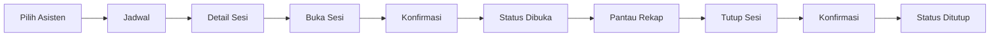
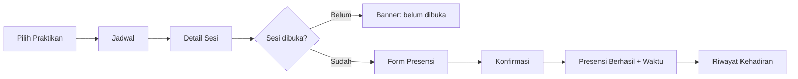

# PRD — Sprint 1: Antarmuka dan Alur Praktikum

## 1. Informasi Dokumen

| Item | Isi |
| --- | --- |
| Produk | Aplikasi Presensi Praktikum (nama kerja: PPK Presence) |
| Sprint | Sprint 1 — Antarmuka dan Alur Praktikum |
| Versi dokumen | 1.0 |
| Status | Final untuk Sprint 1 |
| Pemilik | PM |
| Terakhir diperbarui | 21 Oktober 2026 |
| Platform | Android & iOS (Expo / React Native) |
| Data | Dummy, state lokal di memori |

Dokumen ini menjelaskan **apa yang dibangun dan mengapa**. Detail teknis ada di `arsitektur.md`, `data-model.md`, dan `navigasi-ui.md`. Kriteria lulus ada di `acceptance-criteria.md`.

---

## 2. Latar Belakang

Kegiatan praktikum membutuhkan pencatatan kehadiran yang cepat dan jelas. Asisten perlu mengelola sesi, sementara praktikan perlu mengetahui jadwal, melakukan presensi, dan melihat riwayat kehadirannya.

Pada Sprint 1, aplikasi dibangun sebagai prototipe front-end yang mendemonstrasikan alur tersebut memakai data dummy. Belum ada backend, autentikasi, atau sinkronisasi antar perangkat.

---

## 3. Problem Statement

1. Praktikan tidak memiliki tampilan terpusat untuk melihat jadwal, status sesi, dan mencatat kehadiran.
2. Asisten tidak memiliki alat sederhana untuk membuka/menutup sesi dan memantau kehadiran.
3. Tidak ada umpan balik yang jelas apakah presensi berhasil, sudah tercatat, atau tidak diizinkan.
4. Status sesi dan data kehadiran berisiko tidak konsisten antar layar jika tidak ada satu sumber data.

---

## 4. Tujuan Produk

| ID | Tujuan | Indikator berhasil |
| --- | --- | --- |
| G-01 | Praktikan dapat melihat jadwal dan detail sesi | Jadwal menampilkan praktikum, kelas, waktu, ruang, dan status |
| G-02 | Asisten dapat mengelola sesi | Sesi bisa dibuka dan ditutup, status berubah di semua layar terkait |
| G-03 | Praktikan dapat presensi dengan jelas | Presensi hanya saat sesi dibuka, waktu tercatat, ada umpan balik sukses |
| G-04 | Presensi tidak dapat dilakukan dua kali | Form hilang setelah presensi; reducer menolak duplikasi |
| G-05 | Asisten dapat melihat rekap | Daftar hadir + waktu + hitungan hadir tersedia per sesi |
| G-06 | Praktikan dapat melihat riwayat | Riwayat menampilkan status hadir/tidak hadir per sesi |
| G-07 | Interaksi mudah dipahami | Form, modal/bottom sheet, dan empty state digunakan dengan jelas |

---

## 5. Non-Goals (Sprint 1)

- Login, registrasi, dan manajemen akun.
- Backend, database, API, atau sinkronisasi antar perangkat.
- CRUD jadwal dan kelas oleh asisten.
- QR code, GPS, face recognition, atau validasi lokasi.
- Status terlambat/alpha otomatis.
- Push notification.
- Dark mode dan internasionalisasi.
- Dashboard admin/dosen.
- Export rekap ke PDF/Excel.

---

## 6. Target Pengguna dan Persona

### Persona 1 — Praktikan

- **Nama contoh:** Budi Santoso, NIM 2310511001, Kelas PPK A.
- **Kebutuhan:** tahu kapan praktikum, apakah sesi sudah dibuka, bisa presensi tanpa langkah berbelit, dan bisa mengecek riwayat.
- **Pain point:** tidak tahu status sesi, takut presensi gagal, tidak punya bukti waktu hadir.
- **Konteks pemakaian:** di ruang praktikum, satu tangan, koneksi tidak stabil (tidak masalah karena data lokal).

### Persona 2 — Asisten

- **Nama contoh:** Nauval, asisten PPK.
- **Kebutuhan:** membuka sesi saat praktikum dimulai, memantau siapa yang sudah presensi, menutup sesi setelah selesai.
- **Pain point:** rekap manual, status sesi tidak jelas, lupa menutup sesi.
- **Konteks pemakaian:** memimpin sesi sambil berinteraksi dengan banyak praktikan.

### Di luar scope

Dosen, koordinator laboratorium, dan admin program studi belum menjadi pengguna sprint ini.

---

## 7. User Stories dan Prioritas

Prioritas memakai MoSCoW: **Must**, **Should**, **Could**, **Won't**.

| ID | User story | Prioritas |
| --- | --- | --- |
| US-01 | Sebagai pengguna, aku dapat memilih peran dan identitas dummy sebelum masuk | Must |
| US-02 | Sebagai praktikan, aku dapat melihat daftar jadwal kelas yang kuikuti | Must |
| US-03 | Sebagai asisten, aku dapat melihat semua jadwal sesi | Must |
| US-04 | Sebagai pengguna, aku dapat membuka detail sesi | Must |
| US-05 | Sebagai asisten, aku dapat membuka sesi yang dijadwalkan | Must |
| US-06 | Sebagai asisten, aku dapat menutup sesi yang sedang dibuka | Must |
| US-07 | Sebagai praktikan, aku dapat presensi saat sesi dibuka | Must |
| US-08 | Sebagai praktikan, aku mendapat bukti waktu presensi | Must |
| US-09 | Sebagai praktikan, aku tidak bisa presensi dua kali pada sesi yang sama | Must |
| US-10 | Sebagai asisten, aku dapat melihat rekap kehadiran per sesi | Must |
| US-11 | Sebagai praktikan, aku dapat melihat riwayat kehadiranku | Must |
| US-12 | Sebagai pengguna, aku melihat empty state saat data kosong | Must |
| US-13 | Sebagai pengguna, aku mendapat konfirmasi sebelum aksi penting | Must |
| US-14 | Sebagai pengguna, aku dapat berganti peran/identitas | Should |
| US-15 | Sebagai pengguna, aku dapat mereset data demo | Could |
| US-16 | Sebagai pengguna, aku dapat memfilter jadwal berdasarkan status | Won't (sprint ini) |
| US-17 | Sebagai pengguna, aku dapat mencari sesi berdasarkan nama | Won't (sprint ini) |
| US-18 | Sebagai asisten, aku dapat mengubah jadwal | Won't (sprint ini) |

---

## 8. Functional Requirements

| ID | Requirement | Prioritas | AC |
| --- | --- | --- | --- |
| FR-01 | Aplikasi menyediakan form pilihan peran (praktikan/asisten) dan identitas dummy. Tombol masuk disabled sampai identitas dipilih | Must | AC-01 |
| FR-02 | Navigasi menampilkan tab berbeda per peran: praktikan (Jadwal, Kehadiran, Profil), asisten (Jadwal, Rekap, Profil) | Must | AC-02 |
| FR-03 | Daftar jadwal menampilkan nama praktikum, kelas, topik, tanggal, jam, ruang, status, dan meta kehadiran | Must | AC-03 |
| FR-04 | Praktikan hanya melihat sesi kelasnya; asisten melihat semua sesi | Must | AC-03 |
| FR-05 | Detail sesi menampilkan informasi lengkap dan aksi sesuai peran | Must | AC-04 |
| FR-06 | Asisten dapat membuka sesi `dijadwalkan` setelah konfirmasi; status berubah menjadi `dibuka` di semua layar | Must | AC-05 |
| FR-07 | Asisten dapat menutup sesi `dibuka` setelah konfirmasi; status berubah menjadi `ditutup` | Must | AC-06 |
| FR-08 | Praktikan hanya dapat presensi saat sesi `dibuka`; form berisi catatan opsional dan checkbox konfirmasi | Must | AC-07, AC-08 |
| FR-09 | Presensi mencatat waktu kehadiran dan menampilkan umpan balik sukses | Must | AC-08 |
| FR-10 | Satu praktikan hanya boleh memiliki satu presensi per sesi; UI dan reducer sama-sama mencegah duplikasi | Must | AC-09 |
| FR-11 | Asisten melihat rekap nama, NIM, waktu, badge hadir, dan hitungan `X/Y hadir` | Must | AC-10 |
| FR-12 | Praktikan melihat riwayat kehadiran sendiri dengan status hadir/belum/tidak hadir | Must | AC-11 |
| FR-13 | Setiap daftar memiliki empty state yang menjelaskan kondisi | Must | AC-12 |
| FR-14 | Konfirmasi aksi memakai Modal/Bottom Sheet | Must | AC-13 |
| FR-15 | Form dan validasi digunakan untuk pilihan peran/identitas serta presensi | Must | AC-14 |
| FR-16 | Pengguna dapat berganti peran/identitas tanpa menghapus data sesi/presensi | Should | AC-17 |
| FR-17 | Pengguna dapat mereset data demo ke kondisi awal | Could | AC-17 |
| FR-18 | Route yang tidak sesuai peran diarahkan ulang; sesi yang tidak ada menampilkan state khusus | Must | AC-18 |

---

## 9. Non-Functional Requirements

| ID | Kategori | Requirement |
| --- | --- | --- |
| NFR-01 | Usability | Presensi dapat diselesaikan maksimal 3 langkah dari detail sesi: isi form → konfirmasi → sukses |
| NFR-02 | Usability | Buka/tutup sesi maksimal 2 langkah: tekan tombol → konfirmasi |
| NFR-03 | Responsif | Tidak ada horizontal scroll pada lebar 320 px; konten maksimal 800 px dan center di layar lebar |
| NFR-04 | Aksesibilitas | Target sentuh minimal 44×44; status tidak hanya dibedakan warna; label form jelas |
| NFR-05 | Konsistensi | Semua layar membaca satu `AppState`; tidak ada salinan status sesi di local state |
| NFR-06 | Kinerja | Daftar memakai `FlatList`; interaksi lokal terasa instan tanpa loading state palsu |
| NFR-07 | Maintainability | TypeScript strict; `npx tsc --noEmit` dan `npx eslint .` bersih |
| NFR-08 | Platform | Berjalan di Android dan iOS melalui Expo; web hanya bonus |
| NFR-09 | Data | Data dummy in-memory; reload mengembalikan kondisi awal; tidak ada persistensi |
| NFR-10 | Keamanan | Tidak ada data sensitif; tidak ada kredensial yang disimpan di repo |

---

## 10. Prinsip UX

1. **Satu tugas utama per layar** — jangan mencampur kontrol asisten dan form praktikan.
2. **Status selalu terlihat** — badge teks + warna di jadwal dan detail.
3. **Aksi penting butuh konfirmasi** — buka sesi, tutup sesi, presensi, ganti pengguna.
4. **Umpan balik langsung** — setelah aksi, layar berubah tanpa perlu reload.
5. **Empty state memberi arahan** — jelaskan apa yang belum ada dan langkah berikutnya.
6. **Bahasa konsisten** — Indonesia, sapaan “kamu”, istilah praktikum yang familiar.
7. **Aman dari kesalahan** — tombol disabled saat tidak valid; aksi destruktif diberi tone danger.

---

## 11. Alur Utama

### Alur asisten membuka sesi

### Alur praktikan presensi

### Alur demo end-to-end

Asisten buka sesi → ganti ke praktikan → presensi → ganti ke asisten → lihat rekap → tutup sesi → cek riwayat praktikan. Detail langkah ada di `acceptance-criteria.md`.

---

## 12. Data dan Konten

- **Pengguna dummy:** 1 asisten + 4 praktikan (3 kelas).
- **Praktikum:** 1 praktikum (Pemrograman Komputer).
- **Kelas:** PPK A, PPK B, PPK C.
- **Sesi:** 5 sesi; 1 sesi hari ini berstatus `dijadwalkan` untuk demo buka sesi.
- **Presensi awal:** 3 record untuk mengisi riwayat dan rekap.
- **Kelas C** sengaja tidak punya sesi untuk menguji empty state.
- **Waktu:** relatif terhadap hari ini saat data dimuat.
- **Bahasa:** Indonesia.

Detail lengkap ada di `data-model.md`.

---

## 13. Metrik Keberhasilan Sprint

Sprint dianggap berhasil jika:

1. 100% acceptance criteria di `acceptance-criteria.md` lulus.
2. Demo end-to-end berhasil dari kondisi reload bersih.
3. Tidak ada error TypeScript/ESLint.
4. Tidak ada red screen atau `console.error` saat demo.
5. Semua state wajib tersedia: jadwal kosong, rekap kosong, sesi belum dibuka, sudah presensi, sesi ditutup, sesi tidak ditemukan.
6. Pengguna dapat menyelesaikan presensi tanpa kebingungan (dinilai lewat demo dan walkthrough PM).

---

## 14. Asumsi dan Batasan

1. Satu instance aplikasi; peran diganti lewat Profil.
2. Data hilang saat reload; ini bukan bug.
3. Sesi hanya bergerak satu arah: `dijadwalkan → dibuka → ditutup`; sesi ditutup tidak bisa dibuka lagi.
4. Presensi hanya untuk praktikan di kelas sesi tersebut.
5. Tidak ada status terlambat; tidak hadir = tidak ada record.
6. Asisten dapat mengelola semua sesi; belum ada pembatasan kepemilikan.
7. Waktu memakai jam perangkat, bukan jam server.
8. Tidak ada autentikasi; pemilihan identitas hanya untuk demonstrasi.
9. Tidak ada sinkronisasi antar perangkat.

---

## 15. Dependencies dan Risiko

### Dependencies

- Expo SDK 58 + Expo Router.
- Kontrak types/state dari Dev 1.
- Shared UI (`ConfirmSheet`, `StatusBadge`, `EmptyState`, dll).
- `SessionCard` dari Dev 2 untuk layar rekap Dev 3.

### Risiko utama

| Risiko | Dampak | Mitigasi |
| --- | --- | --- |
| Status sesi tidak konsisten antar layar | Demo membingungkan | Semua layar membaca state yang sama; tidak menyimpan salinan status |
| Presensi ganda | Data tidak valid | Guard di reducer + UI menyembunyikan form |
| File bentrok antar programmer | Merge conflict | Peta kepemilikan file + PR review |
| Layout overflow di HP kecil | UI rusak | Uji 320 px, `flexShrink`, `numberOfLines`, `ScrollView` |
| Data demo habis saat presentasi | Demo gagal | Reload aplikasi atau Reset Data Demo |
| Scope melebar | Sprint tidak selesai | Non-goals ditetapkan; fitur baru masuk backlog |

---

## 16. Milestone

| Milestone | Fokus | Exit criteria |
| --- | --- | --- |
| M0 | Contract & skeleton | Aplikasi boot, form peran jalan, tabs tampil, tsc/eslint bersih |
| M1 | Parallel feature | Alur praktikan dan asisten dapat didemokan terpisah |
| M2 | Integration | Alur buka → presensi → rekap → tutup berjalan end-to-end |
| M3 | QA & demo | Semua AC lulus, demo lancar |

Urutan ini adalah dependency, bukan estimasi waktu. Detail tugas ada di `pembagian-tugas.md`.

---

## 17. Open Questions

| Pertanyaan | Keputusan sementara |
| --- | --- |
| Apakah sesi yang ditutup boleh dibuka kembali? | Tidak, untuk menjaga alur demo sederhana |
| Apakah asisten dibatasi pada sesi miliknya? | Tidak, semua asisten dummy dapat mengelola semua sesi |
| Apakah perlu status terlambat? | Tidak, di luar scope sprint |
| Apakah data perlu bertahan setelah reload? | Tidak, state lokal sudah cukup |
| Apakah web perlu didukung penuh? | Tidak, Android/iOS menjadi target utama |
| Apakah repo perlu public? | Private; tim diundang sebagai collaborator |

---

## 18. Glosarium

| Istilah | Arti |
| --- | --- |
| Praktikan | Mahasiswa yang mengikuti praktikum |
| Asisten | Pendamping praktikum yang mengelola sesi |
| Sesi | Pertemuan praktikum pada tanggal dan jam tertentu |
| Presensi | Tindakan mencatat kehadiran praktikan pada sesi |
| Rekap | Daftar kehadiran pada satu sesi |
| Status sesi | `dijadwalkan`, `dibuka`, atau `ditutup` |
| Dummy | Data contoh yang belum terhubung ke backend |
| Empty state | Tampilan saat tidak ada data |
