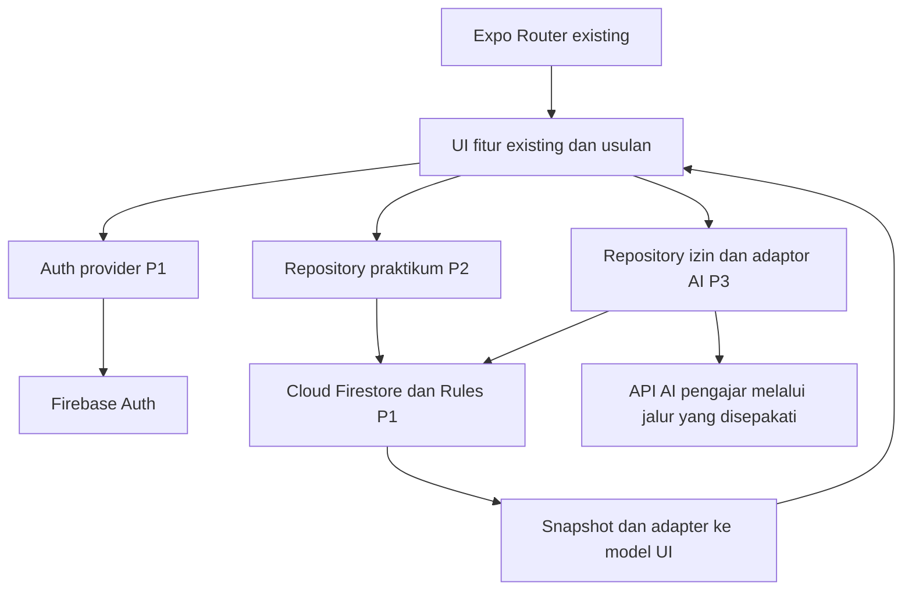
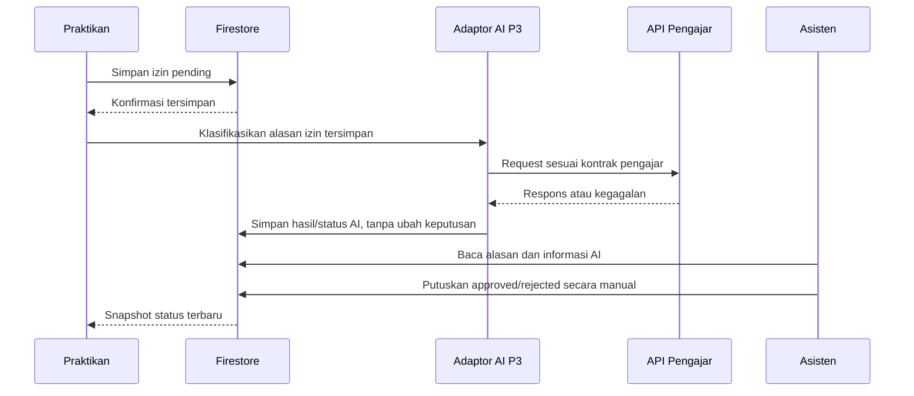

# Arsitektur Aplikasi dan Integrasi Firebase

Dokumen ini memisahkan **temuan codebase** dari **rekomendasi implementasi Sprint 2**. Seluruh modul baru di bawah masih usulan, bukan file yang telah dibuat.

---

## 1. Hasil Inspeksi Repository

| Area | Kondisi yang ditemukan | Implikasi Sprint 2 |
| --- | --- | --- |
| Dependency | Expo `~58.0.16`, React Native `0.88.0`, Expo Router `~58.0.24`; Firebase tidak tercantum dalam `package.json` | P1 memilih dan memasang SDK kompatibel |
| Package manager | `package-lock.json` ada, `bun.lock` tidak ditemukan | Contoh praktikum memakai `npx`; jangan mengganti package manager |
| Entry/navigation | `expo-router/entry`, route di `src/app/` | Pertahankan Expo Router dan route tipis |
| Auth awal | `src/app/index.tsx` memilih peran/identitas dari `state.pengguna` | Alur Firebase harus memakai akun sungguhan, bukan pemilih role |
| State | `src/store/app-context.tsx`: Context/reducer, `useApp()` mengembalikan state/dispatch | Adapter diperlukan; operasi asinkron tidak dimasukkan ke reducer |
| Data | `src/data/dummy.ts` mengisi `initialState`; `src/types/models.ts` memakai ID dummy, field Indonesia, status tiga nilai | UID dan format Firestore tidak boleh dicampur tanpa mapping |
| Query lokal | `src/store/selectors.ts` melakukan join pengguna/praktikum/kelas/sesi/presensi | Dapat dipakai kembali setelah normalisasi snapshot; hindari memuat semua profil privat |
| Fitur existing | Jadwal, detail sesi dua peran, form presensi, kehadiran, rekap, profil | Gunakan kembali layar dan komponen presentasi |
| Shared UI | `src/components/ui/`, `src/components/domain/`, `src/constants/theme.ts`, `src/utils/date.ts` | Reuse komponen dan token; perubahan shared oleh pemilik tunggal |
| Pengujian | `tests/core.test.cjs` tersedia | Baseline perilaku reducer dapat menjadi referensi regresi; bukan bukti integrasi Firebase |
| Native | Folder root `ios/`/`android/` tidak ditemukan; `app.json` dan `eas.json` ada | Tidak membuat/edit direktori native manual |
| Modul baru | `src/services/`, `src/features/auth/`, `src/features/izin/` belum ditemukan | Semua path usulan harus dibedakan dari existing |

Sumber format adalah [arsitektur Sprint 1](../sprint-1/arsitektur.md), tetapi ownership lama tidak dipakai untuk Sprint 2. Peta penulis baru ada di [pembagian-tugas.md](./pembagian-tugas.md).

---

## 2. Prinsip dan Layer yang Diusulkan

1. **Contract-first:** skema, status, batas akses, serta bentuk hasil/error disepakati sebelum query dan Rules.
2. **Feature-based:** domain praktikum/presensi milik P2, domain izin/AI milik P3, fondasi Firebase/Auth/Rules milik P1.
3. **Route tipis:** hanya parameter, guard, dan render fitur; non-route tetap di luar `src/app/`.
4. **Satu sumber data daring:** Firestore; Context/hook hanya proyeksi snapshot. Jangan menyatakan sukses hanya karena reducer lokal berubah.
5. **Pertahankan baseline:** kode, data, dan alur Sprint 1 tidak dihapus. Bila mode lokal dipertahankan saat implementasi nanti, pisahkan dari mode Firebase dan jangan menjadikannya fallback sukses saat server gagal.



---

## 3. Struktur Modul Usulan

| Path | Kondisi | Tanggung jawab |
| --- | --- | --- |
| `src/services/firebase/client.ts` | Baru/usulan P1 | Inisialisasi tunggal dan ekspor Auth/Firestore; tidak mengarang config |
| `src/features/auth/` | Baru/usulan P1 | Form login/registrasi dan state Auth/profil |
| `src/store/auth-context.tsx` | Baru/usulan P1 | Lifecycle Auth, UID, profil terpercaya, readiness |
| `src/services/practicum/` | Baru/usulan P2 | CRUD, listener sesi/keanggotaan, mapper data |
| `src/services/attendance/` | Baru/usulan P2 | Pencatatan presensi idempoten dan listener rekap |
| `src/features/praktikum/` | Baru/usulan P2 | Form CRUD kelas/peserta/jadwal/sesi |
| `src/features/izin/` | Baru/usulan P3 | Form, riwayat, daftar pemeriksaan dan keputusan |
| `src/services/leave/`, `src/services/ai/` | Baru/usulan P3 | Persistence izin, normalisasi respons, timeout/retry |
| `src/types/firebase-contracts.ts` | Baru/usulan P1 | Kontrak bersama sesuai kesepakatan tim |
| `src/types/models.ts`, `src/store/app-context.tsx` | Existing/shared P1 | Adapter fondasi dan kompatibilitas; P2/P3 mengirim kebutuhan, bukan mengedit bersamaan |
| `src/store/selectors.ts` | Existing/shared P2 | Penyesuaian join/proyeksi domain; P3 memasok kontrak izin lewat modulnya |

Path usulan bukan perintah membuat file dalam tugas dokumentasi ini. Daftar ownership lengkap dan file global ada di [pembagian-tugas.md](./pembagian-tugas.md).

---

## 4. Setup Firebase dan Lifecycle Authentication

**P1 melakukan seluruh setup:** memperoleh akses/membuat Firebase Project, memilih lingkungan uji dan region, mendaftarkan aplikasi, mengaktifkan Auth dan Firestore, memasang SDK, mengelola config, provisioning akun asisten, indeks dan Security Rules. PM mengoordinasikan kontrak dan memverifikasi hasil.

Rekomendasi awal memakai Firebase JS SDK untuk kebutuhan Auth/Firestore lintas platform. P1 memverifikasi versi dengan Expo SDK 58 sebelum instalasi melalui `npx expo install firebase`. Pilihan SDK native harus disertai evaluasi kebutuhan development build dan konfigurasi oleh P1. Panduan resmi membedakan dukungan JS SDK dan React Native Firebase, termasuk kebutuhan native build pada pilihan kedua. [Panduan Firebase pada Expo](https://docs.expo.dev/guides/using-firebase.md).

Alur readiness yang diusulkan:

```text
Inisialisasi Firebase → tunggu status Auth
  → tanpa akun: form login/registrasi
  → ada akun: baca users/{uid}
      → profil valid: aktifkan query sesuai UID/role
      → profil belum ada/gagal: state pemulihan terbatas, jangan berikan akses default
Logout/pergantian UID → hentikan listener → kosongkan cache pribadi → ganti akun
```

Registrasi dan pembuatan profil bukan satu transaksi lintas Auth/Firestore. Jika akun sudah dibuat tetapi profil gagal, P1 menyediakan retry pembuatan profil UID yang sama dengan role tetap `praktikan`; jangan mencoba membuat akun duplikat. Observer Auth menjadi dasar readiness, sesuai [pengelolaan pengguna Firebase](https://firebase.google.com/docs/auth/web/manage-users).

Role sumbernya `users/{uid}.role` yang dilindungi Rules. Asisten awal hanya diprovisikan oleh P1 lewat akses administratif terpercaya setelah identitas disetujui; aplikasi klien tidak menawarkan promosi role. Auth UID tidak diambil dari input form presensi/izin. Persistensi login lintas peluncuran diverifikasi terpisah dari persistensi dokumen server.

---

## 5. Kontrak Integrasi Antarmodul

| Penyedia → pemakai | Kontrak yang perlu disepakati | Bentuk kegagalan |
| --- | --- | --- |
| P1 → P2/P3 | Satu instance Auth/Firestore, UID, role, status readiness, teardown saat logout | Belum terautentikasi, profil belum siap, permission denied |
| P2 → P3 | Detail sesi/kelas, keanggotaan, status, ID stabil; UI slot/link ke fitur izin | Not found, bukan anggota, data belum dimuat |
| P2/P3 → P1 | Daftar query, field tulis dan aktor yang diizinkan | Rules menolak kontrak yang belum disepakati |
| P3 → P2 | Ringkasan status izin milik UID/sesi untuk ditampilkan; tanpa mengubah jumlah hadir | Izin belum ada, pending, error listener |
| P3 → API pengajar | Adaptor internal alasan → respons ternormalisasi; wire format menunggu pengajar | Timeout, HTTP gagal, respons invalid |

Nama operasi konseptual: daftar/ubah kelas, daftar/ubah anggota, daftar/ubah jadwal, buat/ubah sesi, buka/tutup sesi, catat presensi, ajukan izin, klasifikasikan alasan, putuskan izin, dan subscribe per scope. Operasi tulis mengembalikan hasil server atau error; operasi subscribe mengembalikan fungsi cleanup. Ini kontrak desain, bukan API yang sudah tersedia.

Adapter mempertahankan field UI lama bila praktis: `id ← documentId/uid`, `peran ← role`, `kelasId ← classId`, `praktikanId ← uid`; timestamp server dipetakan ke tampilan tanggal/waktu. Detail semantik status ada di [data-model.md](./data-model.md).

---

## 6. Strategi Real-time dan Rekap

| Scope | Pemilik | Data dan batas query |
| --- | --- | --- |
| Akun aktif | P1 | Profil UID sendiri; hentikan ketika logout/UID berubah |
| Jadwal/kelas | P2 | Keanggotaan UID sendiri → jadwal/sesi per kelas; asisten melihat lingkup praktikum yang disepakati |
| Detail sesi praktikan | P2 | Dokumen sesi dan dokumen presensi UID sendiri |
| Detail/rekap asisten | P2 | Sesi, anggota kelas dan presensi sesi; hindari listener semua presensi sepanjang waktu |
| Izin praktikan | P3 | Query `uid == UID aktif` dan sesi bila diperlukan |
| Pemeriksaan izin | P3 | Query status `pending`, detail sesuai pilihan; status akhir tetap dapat dilihat pemohon |

Rekap dihitung dari snapshot presensi, bukan counter yang dapat ditambah praktikan. Denominator anggota aktif dan informasi akademik harus mengikuti model yang disepakati. Untuk daftar banyak sesi, P2 membatasi sesi yang dimuat dan berbagi subscription yang sama antar pemakai agar tidak menggandakan listener.

Setiap subscription menangani loading awal, empty setelah snapshot kosong, error eksplisit, dan cleanup saat unmount, perubahan sesi/kelas/UID atau logout. Abaikan callback lama sesudah pergantian scope. Listener yang gagal tidak disamakan dengan daftar kosong; sediakan retry terkendali. Pola snapshot, cleanup, dan error mengikuti [listener Firestore](https://firebase.google.com/docs/firestore/query-data/listen).

Data lokal yang menunggu write tidak diberi label final “tersimpan”. Saat offline, tampilkan gangguan sinkronisasi; setelah tersambung, baca kembali konfirmasi server. Rancangan tidak menjanjikan cache offline persisten pada React Native tanpa verifikasi SDK. Data yang sudah dikonfirmasi tersimpan di Firestore harus tetap dapat dibaca setelah restart dan login kembali.

---

## 7. Integrasi API AI dan Kegagalannya



P3 memperoleh endpoint, metode, autentikasi, struktur payload/response, kategori, limit, timeout dan contoh kegagalan dari pengajar. Tidak ada URL/key/kategori contoh yang dianggap benar dalam dokumen ini. Model internal menyimpan klasifikasi sesuai respons tervalidasi; confidence hanya jika kontrak memang menyediakannya.

Jika akses API memerlukan secret, jangan menaruhnya dalam aplikasi, variabel publik, atau repo. PM/pengajar menentukan layanan perantara yang tersedia; P3 mengerjakan adaptor/jalur AI, sedangkan setup layanan Firebase bila diperlukan tetap P1. Jika belum ada jalur aman, catat blocker SRS-06.

Simpan pengajuan terlebih dahulu supaya kegagalan AI tidak menghilangkan alasan. Terapkan timeout yang nilainya ditentukan bersama pengajar, retry manual/terbatas dan penanda percobaan aktif. Kegagalan HTTP/jaringan/respons invalid mengubah **status AI saja**. Cegah respons lama menimpa hasil percobaan baru; update field AI tidak boleh membawa payload keputusan. Respons yang datang setelah keputusan asisten tidak mengubah keputusan tersebut.

---

## 8. Keamanan dan Penanganan Error

| Kondisi | Perilaku yang direkomendasikan |
| --- | --- |
| Auth gagal | Error form aman, tidak log password/token, tombol kembali aktif |
| Auth berhasil tetapi profil gagal | Pemulihan profil terbatas, tidak masuk ke fitur data |
| Rules menolak | Tampilkan akses tidak diizinkan; tidak fallback ke sukses dummy |
| Dokumen hilang/tidak berhak | Pesan tidak tersedia tanpa membocorkan data pengguna lain |
| Jaringan/write gagal | Pertahankan input dan beri retry; periksa dokumen deterministik sebelum mengulang |
| API AI gagal | Izin tetap pending/keputusan manual tetap utuh; hasil ditandai belum tersedia |
| Konflik dua pemeriksa | Keputusan pertama dipertahankan, muat hasil terbaru untuk pemeriksa kedua |

Rules bukan filter: query harus sudah membatasi scope yang boleh dibaca, bukan mengambil semua lalu menyaring di UI. Model akses harus diuji terhadap query nyata. [Kondisi dan query Security Rules](https://firebase.google.com/docs/firestore/security/rules-conditions).

Rancangan akses per koleksi hanya ada di [data-model.md](./data-model.md). P1 meninjau field whitelist bersama P2/P3; UI guard tidak menggantikan database authorization.

---

## 9. Referensi Versi dan Pemeriksaan Integrasi

Versi dibaca dari `package.json`, kemudian dokumentasi [Expo SDK 58](https://docs.expo.dev/versions/v58.0.0/) serta [indeks Expo](https://docs.expo.dev/llms.txt) diperiksa untuk menemukan panduan Firebase. P1 wajib memeriksa ulang kompatibilitas saat implementasi, bukan mengandalkan ingatan API.

Pemeriksaan integrasi mendatang: `npx expo lint`, `npx tsc --noEmit`, pengujian Rules, serta dua demo di [acceptance-criteria.md](./acceptance-criteria.md). Dokumen ini belum menyatakan hasil pengujian fitur.
