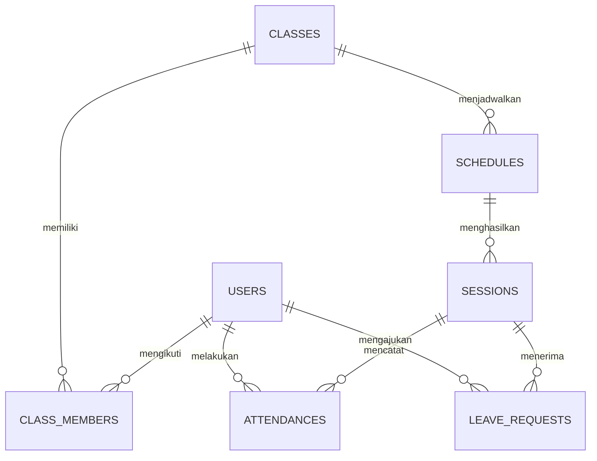

# Data Model, Kontrak Firebase, dan Aturan Bisnis

Seluruh skema di dokumen ini merupakan **usulan yang perlu disepakati tim**, bukan struktur Firestore yang sudah terimplementasi. P1 mengelola fondasi/Rules, P2 domain praktikum/presensi, P3 domain izin/AI. PM memfasilitasi kesepakatan.

---

## 1. Entity Relationship



Identitas relasi pengguna selalu Firebase Authentication UID. `asisten-1`/`praktikan-1` dari dummy tidak menjadi UID akun nyata. Kelas dapat mempunyai banyak anggota; satu jadwal dapat mempunyai beberapa sesi konkret. Satu presensi dan usulan satu izin per UID/sesi.

---

## 2. Rancangan Koleksi

Timestamp audit memakai waktu server; `null` untuk nilai yang belum ada, bukan nilai waktu palsu. Nama field berikut adalah kontrak penyimpanan yang diusulkan; adapter ke model UI lama dijelaskan di [arsitektur.md](./arsitektur.md).

| Path | Field minimum usulan | Relasi/penulis |
| --- | --- | --- |
| `users/{uid}` | `uid`, `role`, `nama`, `email`, `nim` atau `nip`, `createdAt`, `updatedAt` | ID = Auth UID; P1 untuk registrasi/profil; password tidak disimpan di Firestore |
| `classes/{classId}` | `nama`, `praktikumId`, `praktikumNama`, `praktikumKode`, `archived`, `createdBy`, `createdAt`, `updatedAt` | Asisten mengelola lewat fitur P2; metadata praktikum menjadi sumber remote bagi UI |
| `classMembers/{memberId}` | `classId`, `uid`, `nama`, `nim`, `active`, `createdAt`, `updatedAt` | Keanggotaan peserta terdaftar; identitas akademik dikelola asisten P2; UID tidak diganti melalui update |
| `schedules/{scheduleId}` | `classId`, `startAt`, `endAt`, `ruang`, `archived`, `createdBy`, `createdAt`, `updatedAt` | Jadwal dasar milik kelas; `startAt < endAt` |
| `sessions/{sessionId}` | `classId`, `scheduleId`, `asistenUid`, `asistenNama`, `topik`, `startAt`, `endAt`, `ruang`, `status`, `openedAt`, `closedAt`, `archived`, `createdAt`, `updatedAt` | Sesi konkret; jadwal/kelas harus ada dan cocok; timestamp pelaksanaan terpisah dari rencana |
| `sessions/{sessionId}/attendances/{uid}` | `uid`, `sessionId`, `classId`, `status: hadir`, `recordedAt`, `catatan` | ID = UID; create oleh pemilik, tidak boleh update/delete dari klien |
| `leaveRequests/{requestId}` | `uid`, `sessionId`, `classId`, `alasan`, `status`, `ai`, `reviewedBy`, `reviewedAt`, `reviewNote`, `createdAt`, `updatedAt` | Pemohon membuat `pending`; AI dan keputusan terpisah; asisten memeriksa |

`memberId` dan usulan `requestId` dibuat deterministik dari pasangan classId/UID atau sessionId/UID. Tim harus menyepakati encoder pasangan yang bebas tabrakan serta tervalidasi Rules; batasi ID sesi/kelas agar tidak mengandung delimiter yang dipilih. Bentuk konseptual `classId + separator + uid` bukan izin membuat ID acak. P1/P2/P3 harus memakai derivasi identik untuk lookup keanggotaan dan pencegahan izin ganda.

Nama/NIM di `classMembers` adalah direktori akademik kelas untuk rekap; bukan sumber role. P2 mengelola data peserta di sana, sementara P1 tetap mengelola identitas akun/Auth. Jika nama akademik berubah, rekap mengambil data anggota terbaru; kesepakatan apakah histori memerlukan snapshot nama dicatat PM. Email dan profil privat tidak perlu dibuka ke sesama praktikan.

Metadata praktikum pada kelas dan nama asisten pada sesi menghindari kebutuhan membaca seluruh profil pengguna untuk join UI. Field duplikasi ini hanya boleh ditulis asisten terpercaya dan harus konsisten melalui layanan P2. Penambahan koleksi `practicums` bukan kewajiban skema awal; bila tim memilihnya, kontrak/query/Rules harus direvisi bersama sebelum implementasi.

---

## 3. Kontrak Nilai dan Transisi

### Role

Nilai hanya `praktikan` dan `asisten`. Registrasi klien selalu `praktikan`. Pembuatan role asisten dilakukan P1 melalui console/alat administratif terpercaya dengan persetujuan identitas; pengguna tidak dapat membuat profil asisten, mengganti role, atau menghapus lalu membuat ulang profil untuk eskalasi.

### Status sesi dan kompatibilitas Sprint 1

Nilai persisten hanya `open` dan `closed`. Karena UI existing membedakan `dijadwalkan`, `dibuka`, dan `ditutup`, usulan berikut memakai audit timestamp untuk membedakan sesi belum pernah dibuka:

| Kondisi Firestore | Label/model UI existing | Aksi |
| --- | --- | --- |
| `closed`, `openedAt = null`, `closedAt = null` | `dijadwalkan` / Dijadwalkan | Asisten dapat membuka |
| `open`, `openedAt` terisi, `closedAt = null` | `dibuka` / Dibuka | Praktikan dapat presensi, asisten dapat menutup |
| `closed`, `openedAt` dan `closedAt` terisi | `ditutup` / Ditutup | Arsip, tidak dibuka ulang |

Pembuatan sesi dimulai pada kondisi pertama. Buka mengisi `openedAt` dengan waktu server; tutup mengisi `closedAt`. Rules mengikat kombinasi field dan urutan tersebut. Usulan ini mempertahankan alur tiga tahap Sprint 1 tanpa menambah nilai status di luar `open/closed`; PM dan programmer perlu menyepakatinya.

### Presensi dan rekap

Status record presensi diusulkan `hadir`. Tidak memiliki record bukan dokumen `tidak-hadir`; status tampilan diturunkan dari sesi, presensi dan keputusan izin. Jumlah hadir = banyak dokumen presensi valid sesi. Denominator usulan = anggota aktif kelas; bila anggota berubah, angka dapat berubah. Untuk histori tetap, snapshot roster memerlukan keputusan tambahan PM, bukan diasumsikan tersedia.

Izin `approved` ditampilkan sebagai **Izin diterima**, bukan ditambahkan ke jumlah hadir. Usulan prioritas tampilan: ada presensi → Hadir; tanpa presensi dengan izin disetujui → Izin diterima; izin pending → Izin menunggu; lainnya mengikuti status sesi. Izin rejected tetap terlihat sebagai keputusan terpisah. Usulan mengizinkan presensi bila sesi masih terbuka walaupun izin sudah diajukan; kedua catatan tetap terpisah dan asisten melihat keduanya.

### Izin dan hasil AI

```text
status keputusan: pending → approved ATAU rejected (oleh asisten saja)
status AI: not_requested → processing → succeeded ATAU failed
retry AI: failed → processing (tidak mengubah status keputusan)
```

Objek `ai` usulan: `state`, `classification` (null sampai respons valid), `classifiedAt`, `errorCode` aman, `attemptId`. Nilai kategori dan bentuk hasil klasifikasi **menunggu kontrak pengajar**; jangan menganggap `approved/rejected` sebagai hasil klasifikasi AI. `reviewedBy`, `reviewedAt`, `reviewNote` berada di luar objek `ai`. Keputusan final tidak dapat direvisi pada scope usulan ini.

---

## 4. Invarian dan Validasi Data

| Area | Usulan aturan yang perlu ditegakkan klien dan Rules |
| --- | --- |
| Seluruh dokumen | Field wajib, whitelist field tambahan, tipe, enum, timestamp, immutable ID/relasi; default deny |
| Profil | UID dokumen sama dengan UID Auth; role hanya sumber terpercaya; pengguna hanya mengubah nama profil yang diizinkan |
| Kelas/peserta | Referensi kelas/UID valid; keanggotaan unik; perubahan roster hanya asisten; peserta aktif saja boleh menulis presensi/izin baru |
| Jadwal/sesi | Mulai sebelum selesai; kelas dan jadwal cocok; asistenUid mengacu role asisten; field audit tidak dikirim bebas oleh pengguna |
| Catatan presensi | Opsional, trim, usulan maksimal 120 karakter mengikuti form existing |
| Alasan izin | Wajib, trim, usulan 1–1000 karakter; batas final disepakati PM dan batas API pengajar |
| Keputusan | Hanya `pending → approved/rejected`; pemeriksa = UID asisten aktif; waktu server; immutable alasan/UID/sesi |
| AI | Hanya field AI boleh berubah pada operasi klasifikasi; validasi bentuk final setelah kontrak pengajar tersedia |

Usulan pengajuan izin: boleh pada sesi kelas yang belum diarsipkan, baik sebelum dibuka, terbuka, maupun selesai; satu permohonan per UID/sesi dan tanpa edit/hapus klien setelah kirim. Batas waktu pengajuan adalah keputusan tim yang belum final. Pemohon dapat tetap membaca dokumen miliknya setelah keanggotaan dinonaktifkan, tetapi tidak membuat catatan baru.

---

## 5. Pencegahan Presensi Ganda di Database

1. Lokasi dokumen tetap `sessions/{sessionId}/attendances/{auth.uid}`; jangan auto-ID.
2. P2 mengusulkan transaksi membaca sesi, keanggotaan, serta presensi UID. Jika belum ada dan sesi terbuka, buat dokumen dengan waktu server.
3. P1 menulis Rules: hanya create untuk UID path/payload yang sama dengan Auth; role praktikan, anggota aktif, sesi `open`, referensi konsisten. Semua update/delete presensi klien ditolak.
4. Dua request bersamaan menargetkan dokumen yang sama. Setelah salah satu create diterima, percobaan menimpa menjadi update yang ditolak; transaksi yang diulang membaca dokumen existing dan mengembalikan status sudah presensi.
5. Tombol disabled adalah bantuan UX, bukan proteksi utama. Kegagalan/tidak pasti akibat jaringan dipulihkan dengan membaca dokumen yang sama, bukan membuat ID baru.

Usulan transaksi ini juga digunakan P3 untuk keputusan izin: baca status masih `pending`, tulis keputusan final, lalu Rules menolak transisi dari status final. Callback transaksi harus bebas panggilan AI/efek UI karena dapat diulang. Transaksi dapat gagal offline; jangan menjanjikan konfirmasi sukses saat itu. [Transaksi Firestore](https://firebase.google.com/docs/firestore/manage-data/transactions).

---

## 6. Rancangan Firebase Security Rules

Bagian ini adalah matriks kebijakan, bukan file Rules siap deploy. **P1 menulis, menguji, dan menerapkan Rules** setelah kontrak disetujui.

| Path | Baca | Create | Update/delete |
| --- | --- | --- | --- |
| `users/{uid}` | Pemilik; asisten terpercaya untuk lookup peserta yang dibutuhkan | Pemilik UID sendiri, role awal wajib praktikan dan field terbatas | Pemilik hanya nama yang diizinkan; role/UID/identitas akademik tidak dapat diubah klien; delete klien ditolak |
| `classes/{id}` | Asisten; praktikan anggota kelas, termasuk riwayat nonaktif sesuai kesepakatan | Asisten | Asisten; kebijakan hapus/arsip di bagian 7 |
| `classMembers/{id}` | Asisten; praktikan hanya dokumen UID sendiri | Asisten; UID praktikan dan kelas valid | Asisten; UID/classId immutable; peserta tidak bisa mendaftarkan diri |
| `schedules/{id}` | Asisten; anggota kelas terkait | Asisten dengan kelas valid | Asisten, validasi referensi dan penghapusan |
| `sessions/{id}` | Asisten; anggota kelas terkait | Asisten, status awal/audit valid | Asisten, transisi sesi dan relasi valid; penghapusan sesuai bagian 7 |
| `sessions/{id}/attendances/{uid}` | Asisten; praktikan hanya UID sendiri | Pemilik praktikan aktif, sesi terbuka; kriteria bagian 5 | Semua update/delete klien ditolak |
| `leaveRequests/{id}` | Asisten; pemohon UID sendiri | Praktikan aktif di kelas sesi; status pending; review null; AI awal kosong | Pemohon hanya field proses/hasil AI yang diizinkan; asisten hanya field keputusan dari pending; delete klien ditolak |
| Path lain | Ditolak | Ditolak | Ditolak |

Role ditentukan dari dokumen profil yang tidak dapat dipromosikan klien. Setiap update memakai pembatasan field yang berubah, bukan hanya pemeriksaan role; status final dan identitas tetap tidak dapat dimutasi. [Pembatasan field pada Rules](https://firebase.google.com/docs/firestore/security/rules-fields).

Untuk AI langsung dari mobile, hasil yang ditulis pemohon harus ditandai sebagai **hasil yang dilaporkan klien**, bukan bukti respons tepercaya. Pemohon tetap tidak dapat menulis field keputusan. Bila pengajar mensyaratkan hasil yang dapat dipercaya, usulkan perantara server: hanya perantara yang menulis hasil AI dan Rules menolak update AI dari klien. Tim harus memilih jalur ini sebelum implementasi; kredensial admin/server tidak pernah dibagikan ke aplikasi. P3 mengerjakan jalur AI, P1 menangani setup Firebase dan kebijakan aksesnya. Server berprivilege juga wajib memvalidasi UID/payload karena tidak mengandalkan Rules klien.

Query praktikan pada izin/keanggotaan harus membatasi UID, query jadwal/sesi membatasi kelas yang berhak. Jangan melakukan query semua pengguna/presensi lalu menyaring di aplikasi. Uji bentuk query sebenarnya bersama Rules dan rencanakan indeks yang diperlukan; provisioning indeks Firebase milik P1 berdasarkan daftar query P2/P3.

---

## 7. CRUD, Relasi, dan Penghapusan

Usulan: **hapus fisik** dipakai hanya untuk data uji/entitas tanpa relasi; data berelasi memakai `archived` atau `active = false` agar presensi/izin tetap terbaca. Untuk membuktikan CRUD, P2 menyiapkan kelas, anggota, jadwal dan sesi uji yang aman dihapus; menghapus keanggotaan berarti mencabut peserta dari kelas, bukan menghapus akun Auth.

Rules tidak diasumsikan dapat mencari seluruh dokumen dependen untuk memastikan tidak ada referensi. Sebelum mengizinkan hapus fisik master, P1/P2 harus memilih mekanisme terjamin, misalnya guard relasi yang hanya diubah secara atomik dengan validasi, atau operasi penghapusan melalui layanan terpercaya yang memeriksa dependensi dan mencegah race. Jika belum tersedia, hapus fisik klien ditolak dan SRS-02 bagian delete dicatat belum terpenuhi; arsip saja tidak diklaim membuktikan delete fisik.

Jangan menganggap penghapusan dokumen sesi menghapus subkoleksi presensi. Data sesi yang sudah memiliki audit, presensi atau izin harus dipertahankan/diarsipkan. Referensi `classId`/`scheduleId` pada sesi dibuat immutable pada usulan awal; perubahan waktu/topik/ruang tetap dapat dilakukan sesuai validasi. Tim perlu menetapkan apakah edit waktu setelah sesi dibuka dibatasi.

---

## 8. Checklist Kesepakatan Kontrak

Seluruh item belum dijalankan; PM mencatat keputusan, programmer mengimplementasikan bagiannya.

- [ ] P1/P2/P3 menyetujui field, tipe, ID deterministik dan mapping ke UI existing.
- [ ] UID, sumber role, provisioning asisten, dan pemulihan profil disepakati.
- [ ] Semua asisten vs pembatasan kelas tertentu diputuskan konsisten pada Rules dan query.
- [ ] Pemetaan status sesi, timestamp, izin, dan status AI disetujui.
- [ ] Batas alasan, waktu pengajuan, duplikasi, konflik hadir/izin dan finalitas keputusan disepakati.
- [ ] Mekanisme delete aman serta arsip/riwayat disepakati dan tidak hanya divalidasi di UI.
- [ ] Jalur API/secret, kepercayaan hasil AI, field hasil, timeout dan retry dikonfirmasi pengajar.
- [ ] Daftar query, indeks, cleanup listener dan skenario Rules diserahkan ke P1.
