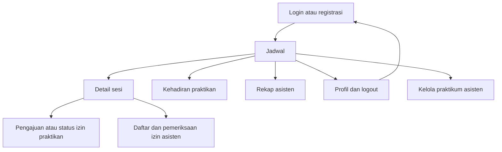

# Navigasi, Layar, dan Spesifikasi UI

Dokumen ini mengembangkan pola UI Sprint 1. Route existing berdasarkan inspeksi repository; route dan layar tambahan adalah **usulan**, belum dibuat. Kepemilikan implementasi ada di [pembagian-tugas.md](./pembagian-tugas.md).

---

## 1. Peta Navigasi



| Route | File | Kondisi | Guard/tujuan Sprint 2 |
| --- | --- | --- | --- |
| `/` | `src/app/index.tsx` | Existing | Pintu login/registrasi; tunggu readiness Auth, profil valid menuju jadwal |
| `/jadwal` | `src/app/(tabs)/jadwal.tsx` | Existing | Akun aktif; praktikan kelas sendiri, asisten sesuai scope |
| `/kehadiran` | `src/app/(tabs)/kehadiran.tsx` | Existing | Praktikan; riwayat sendiri |
| `/rekap` | `src/app/(tabs)/rekap.tsx` | Existing | Asisten; rekap Firestore |
| `/profil` | `src/app/(tabs)/profil.tsx` | Existing | Identitas UID dan role terpercaya, logout |
| `/sesi/[sesiId]` | `src/app/sesi/[sesiId].tsx` | Existing | Auth siap, akses kelas/sesi sesuai Rules |
| `/praktikum` | `src/app/praktikum/index.tsx` | Baru/usulan | Asisten, pintu CRUD empat entitas |
| `/izin/[sesiId]` | `src/app/izin/[sesiId].tsx` | Baru/usulan | Praktikan, form/riwayat izin sesi miliknya |
| `/pemeriksaan-izin` | `src/app/pemeriksaan-izin/index.tsx` | Baru/usulan | Asisten, daftar pengajuan dan detail pemeriksaan |

Usulan tidak menambah tab wajib: kelola praktikum dapat diakses dari Jadwal/Rekap, pemeriksaan dari detail sesi/Rekap, dan izin dari detail sesi/Kehadiran. P2 memasang tautan/slot di layar miliknya; P3 menyediakan layar tujuan. PM mengoordinasikan kontrak route agar P3 tidak mengedit file detail milik P2. Guard navigasi membantu UX, tetapi query/Rules tetap membatasi data.

---

## 2. Komponen Existing yang Digunakan Kembali

| Komponen/path | Pemakaian Sprint 2 yang disarankan |
| --- | --- |
| `src/components/ui/ScreenContainer.tsx` | Container responsif dan safe area |
| `AppCard`, `AppButton`, `FormField` pada `src/components/ui/` | Form Auth, CRUD, presensi dan izin dengan state disabled |
| `ConfirmSheet`, `InfoBanner`, `EmptyState` pada `src/components/ui/` | Konfirmasi, error/retry, daftar kosong |
| `src/components/ui/StatusBadge.tsx` | Status sesi hasil adapter; status izin memakai label terpisah agar makna tidak bercampur |
| `src/components/domain/SessionCard.tsx` | Jadwal dan rekap |
| `src/components/domain/AttendanceRow.tsx` | Nama/NIM/waktu presensi |
| `src/constants/theme.ts`, `src/utils/date.ts` | Token warna/spacing dan format waktu; adapter menangani timestamp sebelum formatting |

Perubahan primitif bersama dikerjakan P1 setelah menerima kebutuhan P2/P3. Komponen khusus izin ditempatkan P3 di `src/features/izin/`, bukan menambah file non-route di `src/app/`.

---

## 3. Login, Registrasi, dan Profil — P1

**Input login:** email, password. **Input registrasi usulan:** nama, NIM, email, password, konfirmasi password. Tidak ada pilihan role asisten pada registrasi publik; daftar kelas bukan sarana mendaftarkan keanggotaan sendiri.

**Perilaku:** validasi jelas per field, password disamarkan, tombol disabled selama submit, pesan error aman, dan loading terpisah ketika Auth sedang dipulihkan atau profil dibaca. Akun Auth tanpa profil ditampilkan sebagai kondisi pemulihan, bukan otomatis diberi hak akses.

**Profil:** menampilkan identitas UID/profil aktif, role dan informasi kelas yang relevan. Logout memanggil Auth, menutup listener, membersihkan cache pribadi, lalu kembali ke login. Pada alur Firebase, kontrol dummy “Ganti Pengguna” menjadi logout/login akun lain. “Reset Data Demo” existing tidak boleh menghapus Firestore; baseline lokal dipertahankan secara terpisah bila tim memilih menyediakan mode demo lokal.

---

## 4. Kelola Praktikum, Jadwal, dan Detail Sesi — P2

### CRUD asisten

| Entitas | Form minimum | Umpan balik |
| --- | --- | --- |
| Kelas | Nama kelas dan metadata praktikum | Berhasil server, duplikat/invalid, konfirmasi hapus/arsip |
| Peserta | Pilih UID praktikan terdaftar, nama/NIM akademik dan kelas | Tidak ditemukan, sudah anggota, aktif/nonaktif |
| Jadwal | Kelas, mulai/selesai, ruang | Waktu invalid, kelas tidak tersedia |
| Sesi | Jadwal, asisten, topik, waktu/ruang konkret | Referensi tidak cocok, sesi tidak tersedia |

Sediakan create/list/detail/edit/delete pada entitas uji tanpa relasi; entitas berelasi mengikuti kebijakan aman di [data-model.md](./data-model.md). Jangan menampilkan “terhapus” bila hanya diarsipkan. Konfirmasi Batal tidak mengubah dokumen.

### Jadwal dan detail

Pertahankan informasi Sprint 1: praktikum, kelas, topik, tanggal/jam, ruang, asisten, badge dan meta kehadiran. Tampilan tiga tahap lama diperoleh melalui mapping `open/closed` dan timestamp, bukan menulis nilai status lama ke database.

Asisten membuka/menutup sesi dengan `ConfirmSheet`; tombol terkunci saat write berlangsung. Praktikan hanya melihat form presensi bila sesi terbuka, anggota aktif dan belum tercatat. Konfirmasi presensi mengirim UID Auth, catatan maksimal usulan 120 karakter, dan waktu server. Status “Presensi berhasil” muncul setelah server mengonfirmasi; pending write ditampilkan berbeda.

Sesi tidak ditemukan atau tidak dapat diakses menampilkan state aman. Jika sesi ditutup saat form sedang terbuka, hentikan submit dan tampilkan status terbaru; penolakan server tetap harus ditangani jika race terjadi.

---

## 5. Rekap dan Kehadiran — P2

Asisten melihat baris peserta, nama/NIM akademik, waktu server yang diformat, dan hitungan hadir. Snapshot presensi memperbarui rekap tanpa refresh. Ketika kosong, tampilkan “Belum ada praktikan yang melakukan presensi”, bukan error jaringan.

Praktikan melihat presensi sendiri dan status izin yang disediakan P3. Izin disetujui diberi label **Izin diterima**, tidak menambah jumlah hadir. Jika kedua catatan ada, tampilkan informasi izin terpisah agar asisten mengetahui konteks. Label final mengikuti prioritas di [data-model.md](./data-model.md).

---

## 6. Pengajuan dan Pemeriksaan Izin — P3

### Praktikan

```text
Detail sesi → Ajukan/Lihat Izin
  Informasi sesi dan kelas
  Alasan [input multiline + hitungan panjang]
  [Kirim Pengajuan]
  Status: Menunggu pemeriksaan
  AI: Belum diproses / Diproses / Hasil tersedia / Gagal
  Keputusan asisten dan waktu pemeriksaan jika tersedia
```

Alasan wajib, trim, tidak boleh hanya spasi. Tampilkan batas sesuai kontrak tim/API. Setelah pengajuan tersimpan, hasil AI ditampilkan pada bagian sendiri dengan keterangan **Informasi pendukung; keputusan oleh asisten**. Gagal klasifikasi menampilkan pesan dan retry yang terkontrol tanpa membuat pengajuan kedua. Setelah keputusan, perubahan hasil AI tidak mengubah label keputusan.

### Asisten

Daftar menampilkan pemohon, sesi, status, dan waktu. Detail menampilkan alasan asli, hasil AI beserta status/keterangan sumber, serta tombol **Terima Izin** dan **Tolak Izin**. Kedua aksi memerlukan pilihan eksplisit dan konfirmasi. Tidak ada default keputusan berdasarkan kategori AI. Bila hasil AI belum tersedia/gagal, asisten tetap dapat membaca alasan dan memutuskan manual sesuai kebijakan tim.

Sesudah keputusan tersimpan, tombol keputusan dinonaktifkan. Jika pemeriksa lain telah memutuskan terlebih dahulu, tampilkan hasil terbaru dan jangan menimpanya.

---

## 7. Matriks State Layar

Semua state di bawah adalah target implementasi yang belum diuji.

| Layar | Loading | Empty | Error | Disabled/khusus | Sukses |
| --- | --- | --- | --- | --- | --- |
| Auth | Pulihkan Auth/baca profil | Profil belum lengkap | Login/registrasi gagal | Submit berjalan | Identitas siap |
| Jadwal/CRUD | Query/write berjalan | Belum ada data | Denied/jaringan/referensi | Role hanya baca | Server mengonfirmasi perubahan |
| Detail praktikan | Sesi/presensi dimuat | Sesi tidak tersedia | Write gagal | Belum dibuka/ditutup/sudah presensi | Presensi tersimpan |
| Rekap | Snapshot awal | Belum ada presensi | Listener gagal | Role praktikan dibatasi | Jumlah/baris terbaru |
| Izin praktikan | Simpan/klasifikasi | Belum ada pengajuan | API/Firestore gagal | Submit ganda/status final | Pending atau keputusan manual terlihat |
| Pemeriksaan | Daftar/detail dimuat | Tidak ada pengajuan | Write konflik/denied | Sudah diputuskan | Keputusan tersimpan |
| Profil | Profil dimuat | Profil belum siap | Logout/profil gagal | Logout berjalan | Kembali ke login |

---

## 8. Responsif, Aksesibilitas, dan Microcopy

Pertahankan Flexbox, daftar efisien, label form, safe area, target sentuh minimal 44×44, dan teks status yang tidak bergantung pada warna. Uji lebar 320/360/390 px serta tablet 768 px; alasan panjang dan keyboard tidak boleh menutup tombol.

| Konteks | Teks usulan |
| --- | --- |
| Write belum dikonfirmasi | Menunggu konfirmasi penyimpanan… |
| AI gagal | Pengajuan tersimpan. Klasifikasi belum tersedia. |
| Izin pending | Menunggu pemeriksaan asisten |
| Izin approved | Izin diterima oleh asisten |
| Izin rejected | Izin ditolak oleh asisten |
| Tidak ada akses | Data tidak tersedia atau kamu tidak memiliki akses. |
| Konflik pemeriksaan | Pengajuan telah diputuskan. Menampilkan keputusan terbaru. |

Detail pengujian perilaku hanya di [acceptance-criteria.md](./acceptance-criteria.md).
