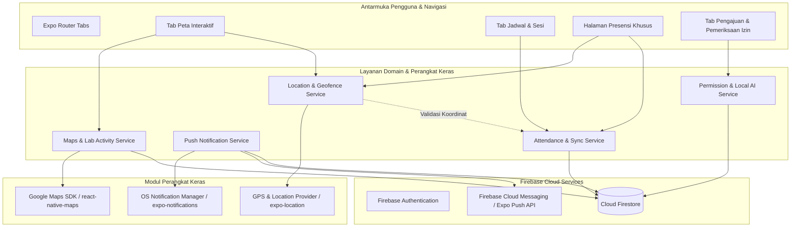
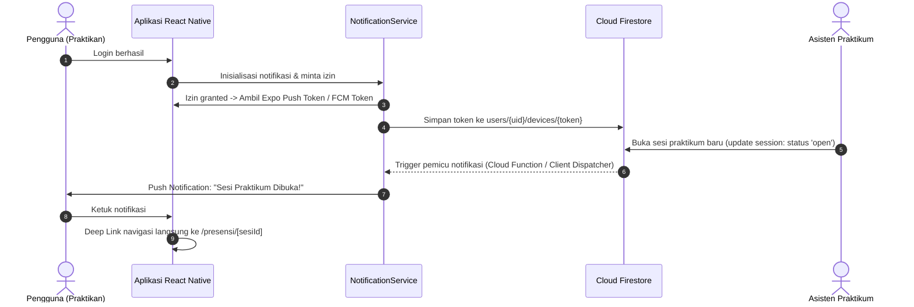

# Arsitektur Aplikasi, Geolocation, Maps, dan Push Notification

Dokumen ini mendefinisikan arsitektur teknis dan integrasi modul untuk **Sprint 3**. Dokumen ini menghubungkan fondasi Firebase dari Sprint 2 dengan kapabilitas perangkat keras: Geolocation, Peta Interaktif, dan Push Notification.

---

## 1. Hasil Inspeksi Codebase dan Kesiapan Sprint 3

| Komponen/Modul | Status di Codebase | Kebutuhan Penyesuaian Sprint 3 |
| --- | --- | --- |
| **Framework & Versi** | Expo SDK `~58.0.16`, React Native `0.88.0`, React `19.3` | Memerlukan dependensi resmi yang kompatibel: `expo-location`, `react-native-maps`, dan `expo-notifications`. |
| **Autentikasi & Role** | `src/contexts/AuthContext.tsx` (`useAuth`), Firestore `users/{uid}` | Diperluas untuk menyimpan token perangkat pengguna (`deviceTokens` / `fcmTokens`) saat login dan mencabutnya saat logout. |
| **Data Praktikum & Sesi** | `src/services/practicumService.ts`, koleksi `classes`, `schedules`, `sessions` | Menambahkan referensi `labId` pada `sessions` dan `schedules` untuk menghubungkan sesi ke titik lokasi laboratorium di peta. |
| **Pencatatan Presensi** | `src/services/attendanceService.ts`, `sessions/{sessionId}/attendances/{uid}` | Diperluas dengan validasi geofence: field `latitude`, `longitude`, `distanceMeters`, dan `geofenceStatus` dicatat saat presensi dikirim. |
| **Modul Izin & AI** | `src/features/permissions/`, `src/services/aiService.ts` | Tetap menggunakan model sentimen lokal murni (`model-edom.json`); keputusan izin asisten memicu push notification ke praktikan. |
| **Navigasi Tab** | `src/app/(tabs)/_layout.tsx` (Jadwal, Kehadiran, Rekap, Izin, Profil) | Menambahkan tab rute baru: Tab Peta (`src/app/(tabs)/peta.tsx`) untuk visualisasi peta laboratorium interaktif. |
| **Halaman Presensi** | Sebelumnya berada di dalam detail sesi | Dipisahkan menjadi halaman khusus: `src/app/presensi/[sesiId].tsx` yang memuat logika geofence terisolasi. |

---

## 2. Diagram Arsitektur Sistem



---

## 3. Desain Layanan Geolocation & Geofencing Engine

### Formula Jarak Geodesi (Haversine Formula)
Untuk menghitung jarak garis lurus antara koordinat perangkat praktikan $(lat_1, lon_1)$ dan koordinat laboratorium $(lat_2, lon_2)$ pada permukaan bumi tanpa membebani library eksternal, digunakan formula Haversine:

$$d = 2R \cdot \arcsin\left(\sqrt{\sin^2\left(\frac{\Delta \phi}{2}\right) + \cos(\phi_1)\cos(\phi_2)\sin^2\left(\frac{\Delta \lambda}{2}\right)}\right)$$

Di mana:
- $R$ adalah radius bumi ($\approx 6.371.000$ meter).
- $\phi_1, \phi_2$ adalah latitude dalam satuan radian.
- $\Delta \phi = \phi_2 - \phi_1$ dan $\Delta \lambda = \lambda_2 - \lambda_1$.
- $d$ adalah jarak dalam meter.

### Logika Evaluasi Geofence
```text
Ambil koordinat pengguna terkini (lat_user, lng_user, accuracy)
  ├── Jika accuracy > 50 meter: Berikan peringatan "Sinyal GPS lemah, mencoba memperoleh lokasi akurat..."
  ├── Hitung jarak d terhadap lab (lat_lab, lng_lab) menggunakan Haversine
  ├── Jika d <= radius_lab:
  │     Status: DALAM_RADIUS (Valid untuk presensi)
  └── Jika d > radius_lab:
        Status: LUAR_RADIUS (Presensi ditolak, tampilkan selisih jarak)
```

Layanan ini diisolasi pada `src/services/location/geofenceService.ts` dan hook `useGeofence.ts`.

---

## 4. Desain Peta Interaktif & Sinkronisasi Aktivitas Lab

### Komponen Peta
- Menggunakan `react-native-maps` (`MapView`, `Marker`, `Circle`, `Callout`).
- **Marker Laboratorium**: Menggunakan pin kustom dengan ikon laboratorium dan status warna (hijau: ada praktikum berlangsung; abu-abu: tidak ada praktikum aktif).
- **Circle Overlay**: Menampilkan lingkaran transparan dengan radius sesuai `radiusMeters` laboratorium untuk memvisualisasikan zona geofence presensi kepada pengguna.
- **Marker Pengguna**: Menampilkan posisi real-time pengguna dengan akurasi arah (*heading/bearing*) jika didukung perangkat.

### Alur Data Aktivitas Lab
1. Halaman Peta berlangganan (*subscribe*) ke koleksi `laboratories`.
2. Saat marker lab diketuk, `useLabActivity(labId)` membaca sesi pada lab tersebut dari koleksi `sessions`:
   - **Ongoing Session**: Sesi dengan `status: 'open'` atau sesi yang dijadwalkan pada hari ini di jam saat ini.
   - **Upcoming Sessions**: 1–3 sesi berikutnya yang diurutkan berdasarkan `startAt` ascending.
3. Bottom sheet menampilkan detail aktivitas secara reaktif: ketika asisten membuka sesi di lab tersebut, badge status sesi di peta langsung berubah menjadi *"Sedang Dibuka"*.

---

## 5. Desain Push Notification & Deep Linking

### Alur Lifecycle Push Notification


### Penanganan Kondisi Notifikasi:
1. **Foreground (Aplikasi Sedang Dibuka)**: Menggunakan `setNotificationHandler` agar notifikasi lokal berupa banner pop-up di dalam aplikasi tetap muncul saat pengguna sedang membuka layar lain.
2. **Background / Terminated (Aplikasi Ditutup)**: Notifikasi ditangani oleh Notification Tray bawaan Android/iOS dengan dukungan suara, getaran, dan ikon aplikasi.
3. **Pembersihan Token (Logout)**: Saat pengguna melakukan logout di `AuthContext`, token perangkat wajib dihapus dari Firestore agar akun lain yang login di perangkat yang sama tidak menerima notifikasi akun sebelumnya.

---

## 6. Struktur Modul dan File Usulan Sprint 3

```text
src/
├── app/
│   ├── (tabs)/
│   │   ├── _layout.tsx                 # Penambahan tab Peta
│   │   └── peta.tsx                    # Layar Peta Interaktif
│   └── presensi/
│       └── [sesiId].tsx                # Layar Presensi Khusus & Validasi Geofence
│
├── features/
│   ├── maps/
│   │   ├── LaboratoryMap.tsx           # Komponen MapView & rendering marker/circle
│   │   ├── LaboratoryMarker.tsx        # Custom marker laboratorium
│   │   ├── UserLocationMarker.tsx      # Marker posisi pengguna real-time
│   │   ├── LabActivitySheet.tsx        # Bottom sheet detail aktivitas lab (ongoing & upcoming)
│   │   └── LabManagementModal.tsx      # Form asisten untuk kelola koordinat/radius lab
│   │
│   ├── presensi/
│   │   ├── GeoAttendanceScreen.tsx     # Komponen inti layar presensi geofence
│   │   ├── LocationStatusCard.tsx      # Kartu informasi jarak, akurasi GPS & status radius
│   │   ├── SessionSummaryCard.tsx      # Kartu informasi sesi praktikum
│   │   └── QrScannerModal.tsx          # (Opsional) Pemindai QR Code sesi
│   │
│   └── notifications/
│       ├── NotificationBell.tsx        # Ikon lonceng notifikasi dengan badge unread
│       └── NotificationPrompt.tsx      # Banner ajakan aktivasi izin notifikasi
│
├── services/
│   ├── location/
│   │   ├── locationService.ts          # Request permission, get current location, watch position
│   │   ├── geofenceService.ts          # Kalkulasi jarak Haversine & evaluasi radius geofence
│   │   └── mockLocation.ts             # Penyedia koordinat simulasi untuk pengujian
│   │
│   ├── maps/
│   │   ├── laboratoryService.ts        # CRUD data lab di Firestore (laboratories/{labId})
│   │   └── labActivityService.ts       # Query aktivitas lab (ongoing & upcoming sessions)
│   │
│   └── notifications/
│       ├── notificationService.ts      # Setup expo-notifications, handler, channel Android
│       ├── tokenRegistryService.ts     # Pendaftaran dan pencabutan token perangkat di Firestore
│       └── notificationDispatcher.ts   # Pemicu pengiriman notifikasi (sesi, jadwal, izin)
│
├── hooks/
│   ├── useUserLocation.ts              # Hook pelacakan lokasi pengguna dengan auto-cleanup
│   ├── useGeofence.ts                  # Hook perhitungan jarak dan status radius real-time
│   └── useNotifications.ts             # Hook listener interaksi notifikasi & deep link
│
└── types/
    ├── laboratory.ts                   # Tipe data Laboratory, GeofenceStatus, GeoPoint
    ├── geoAttendance.ts                # Tipe data GeoAttendanceRecord, VerificationResult
    └── notification.ts                 # Tipe data PushNotificationPayload, DeviceTokenRecord
```

---

## 7. Strategi Optimasi Baterai & Pembersihan Listener

1. **Auto-Cleanup Location Watcher**:
   - `expo-location.watchPositionAsync` mengonsumsi daya GPS yang signifikan.
   - Hook `useUserLocation` wajib mengembalikan fungsi pembersih (*unsubscribe*) pada `useEffect`. Begitu pengguna keluar dari tab Peta atau halaman Presensi, GPS subscription langsung dinonaktifkan.
2. **Pengaturan Akurasi Adaptif**:
   - Pada Peta: Digunakan `Accuracy.Balanced` (akurasi $\approx 10–30$ meter) untuk menghemat daya.
   - Pada Halaman Presensi: Digunakan `Accuracy.High` saat pengguna menekan tombol verifikasi presensi untuk memastikan ketelitian geofence.
3. **Pembersihan Listener Notifikasi**:
   - `addNotificationReceivedListener` dan `addNotificationResponseReceivedListener` wajib di-remove pada lifecycle `componentWillUnmount` / return `useEffect` di tingkat root navigator.
