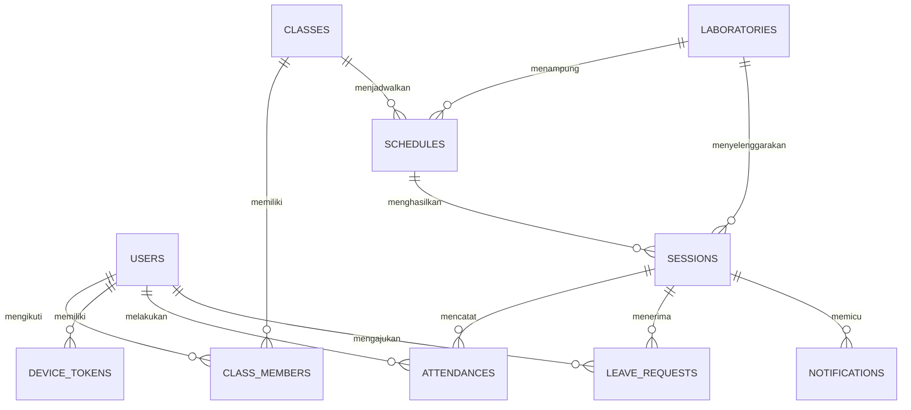

# Data Model, Kontrak Firestore, dan Security Rules — Sprint 3

Dokumen ini mendefinisikan skema data Cloud Firestore, aturan validasi geografis, payload push notification, dan Security Rules untuk **Sprint 3**. Seluruh perubahan memperluas skema Sprint 2 secara terstruktur tanpa merusak data yang telah ada.

---

## 1. Entity Relationship Diagram (ERD)



---

## 2. Rancangan Koleksi Firestore Baru dan Diperbarui

### A. Koleksi Baru: `laboratories/{labId}`
Menyimpan data master laboratorium Informatika beserta koordinat titik acuan dan radius geofence.

| Field | Tipe | Keterangan |
| --- | --- | --- |
| `id` | `string` | ID unik laboratorium (misal: `lab-ai`, `lab-rpl`, `lab-jaringan`) |
| `nama` | `string` | Nama lengkap laboratorium (misal: "Laboratorium Artificial Intelligence") |
| `kode` | `string` | Kode singkat lab (misal: "LAB-AI") |
| `gedung` | `string` | Nama gedung dan lantai (misal: "Gedung Informatika Lt. 3") |
| `latitude` | `number` | Koordinat lintang (-90.0 s/d 90.0) |
| `longitude` | `number` | Koordinat bujur (-180.0 s/d 180.0) |
| `radiusMeters` | `number` | Radius toleransi geofence presensi dalam meter (default: `30`, min: `10`, max: `500`) |
| `kapasitas` | `number` | Kapasitas maksimal praktikan (misal: `40`) |
| `aktif` | `boolean` | Status keaktifan laboratorium (`true` / `false`) |
| `createdBy` | `string` | UID asisten pembuat |
| `createdAt` | `timestamp` | Waktu server pembuatan |
| `updatedAt` | `timestamp` | Waktu server pembaruan |

---

### B. Pembaruan Koleksi: `sessions/{sessionId}`
Memperluas dokumen sesi Sprint 2 dengan mengaitkannya ke entitas laboratorium.

| Field Tambahan | Tipe | Keterangan |
| --- | --- | --- |
| `labId` | `string` | Relasi ke dokumen `laboratories/{labId}` |
| `labNama` | `string` | Snapshot nama lab (menghindari join berlebih di UI jadwal) |
| `labCoordinates` | `map` | Snapshot koordinat: `{ latitude: number, longitude: number }` |
| `radiusMeters` | `number` | Radius geofence yang berlaku untuk sesi ini (diambil dari lab) |
| `qrCodeToken` | `string \| null` | *(Opsional)* Token QR Code aktif jika asisten menggunakan mode presensi QR |

---

### C. Pembaruan Subkoleksi: `sessions/{sessionId}/attendances/{uid}`
Memperluas pencatatan presensi Sprint 2 dengan bukti data lokasi geofence.

| Field | Tipe | Keterangan |
| --- | --- | --- |
| `uid` | `string` | Firebase Auth UID praktikan (ID dokumen tetap = `uid`) |
| `sessionId` | `string` | ID sesi praktikum terkait |
| `classId` | `string` | ID kelas praktikum terkait |
| `status` | `string` | Nilai tetap: `'hadir'` |
| `recordedAt` | `timestamp` | Waktu server pencatatan presensi |
| `latitude` | `number` | Koordinat latitude perangkat saat presensi |
| `longitude` | `number` | Koordinat longitude perangkat saat presensi |
| `accuracy` | `number` | Tingkat akurasi GPS perangkat (meter) saat presensi |
| `distanceMeters` | `number` | Jarak terhitung perangkat ke lab saat presensi |
| `geofenceStatus` | `string` | Status validasi lokasi: `'in_radius'` atau `'bypass_qr'` |
| `catatan` | `string \| null` | Catatan opsional dari praktikan (maks 120 karakter) |

---

### D. Subkoleksi Baru: `users/{uid}/devices/{token}`
Menyimpan token push notification perangkat untuk setiap pengguna aktif.

| Field | Tipe | Keterangan |
| --- | --- | --- |
| `token` | `string` | Expo Push Token atau FCM Device Token |
| `platform` | `string` | Platform OS: `'android'` / `'ios'` / `'web'` |
| `deviceName` | `string \| null` | Nama model perangkat (misal: "Samsung Galaxy A54") |
| `lastActiveAt` | `timestamp` | Waktu terakhir perangkat digunakan |
| `createdAt` | `timestamp` | Waktu pertama pendaftaran token |

---

### E. Koleksi Audit Notifikasi: `notifications/{notificationId}`
Mencatat riwayat pengiriman notifikasi untuk pelacakan dan debugging.

| Field | Tipe | Keterangan |
| --- | --- | --- |
| `id` | `string` | Auto-ID dokumen notifikasi |
| `recipientUid` | `string` | UID penerima notifikasi |
| `type` | `string` | Kategori peristiwa: `'session_opened'`, `'schedule_changed'`, `'leave_decided'` |
| `title` | `string` | Judul notifikasi yang dikirimkan |
| `body` | `string` | Teks isi pesan notifikasi |
| `data` | `map` | Payload metadata untuk deep link navigasi (misal: `{ sessionId: 's1', screen: 'presensi' }`) |
| `status` | `string` | Status pengiriman: `'sent'`, `'delivered'`, `'failed'` |
| `createdAt` | `timestamp` | Waktu server pemicuan notifikasi |

---

## 3. Invarian Data dan Validasi Bisnis

| Area | Aturan Validasi Klien dan Server |
| --- | --- |
| **Koordinat Lab** | Latitude wajib berada dalam rentang $[-90.0, 90.0]$. Longitude wajib berada dalam rentang $[-180.0, 180.0]$. Tipe data wajib `number` presisi pecahan. |
| **Radius Geofence** | Radius toleransi laboratorium minimal `10` meter dan maksimal `500` meter. Nilai non-numerik atau di luar batas ditolak. |
| **Validasi Jarak Presensi** | Presensi ditolak jika `distanceMeters > radiusMeters` sesi, kecuali praktikan menggunakan mode pemindaian token QR asisten yang valid (`geofenceStatus == 'bypass_qr'`). |
| **Pencegahan Presensi Ganda** | Dokumen presensi menggunakan path deterministik `sessions/{sessionId}/attendances/{auth.uid}`. Percobaan presensi kedua ditolak sebagai update ilegal oleh database. |
| **Status Sesi Presensi** | Presensi hanya dapat dibuat jika dokumen sesi terkait berstatus `'open'`. Upaya presensi pada sesi berstatus `'closed'` ditolak oleh aturan database. |
| **Token Notifikasi** | Token push wajib string non-kosong dan hanya dapat ditulis oleh pemilik akun UID terkait. |

---

## 4. Pembaruan Firebase Security Rules (Rancangan Sprint 3)

```javascript
rules_version = '2';
service cloud.firestore {
  match /databases/{database}/documents {
    
    // Fungsi pembantu keamanan Sprint 2
    function isAuthenticated() {
      return request.auth != null;
    }
    function isPraktikan() {
      return isAuthenticated() &&
        get(/databases/$(database)/documents/users/$(request.auth.uid)).data.role == 'praktikan';
    }
    function isAsisten() {
      return isAuthenticated() &&
        get(/databases/$(database)/documents/users/$(request.auth.uid)).data.role == 'asisten';
    }

    // --- KOLEKSI LABORATORIUM (SRS-03) ---
    match /laboratories/{labId} {
      // Seluruh pengguna terautentikasi dapat melihat data laboratorium
      allow read: if isAuthenticated();
      
      // Hanya asisten yang berhak membuat atau memperbarui data laboratorium
      allow create: if isAsisten()
        && request.resource.data.nama is string && request.resource.data.nama.size() > 0
        && request.resource.data.latitude is number
        && request.resource.data.latitude >= -90.0 && request.resource.data.latitude <= 90.0
        && request.resource.data.longitude is number
        && request.resource.data.longitude >= -180.0 && request.resource.data.longitude <= 180.0
        && request.resource.data.radiusMeters is number
        && request.resource.data.radiusMeters >= 10 && request.resource.data.radiusMeters <= 500;
        
      allow update: if isAsisten()
        && request.resource.data.latitude >= -90.0 && request.resource.data.latitude <= 90.0
        && request.resource.data.longitude >= -180.0 && request.resource.data.longitude <= 180.0
        && request.resource.data.radiusMeters >= 10 && request.resource.data.radiusMeters <= 500;
        
      allow delete: if false; // Lab diarsipkan, tidak dihapus fisik
    }

    // --- PRESENSI BERBASIS LOKASI (SRS-02) ---
    match /sessions/{sessionId}/attendances/{uid} {
      allow read: if isAuthenticated() && (request.auth.uid == uid || isAsisten());
      
      allow create: if isPraktikan()
        && request.auth.uid == uid
        && get(/databases/$(database)/documents/sessions/$(sessionId)).data.status == 'open'
        && request.resource.data.uid == request.auth.uid
        && request.resource.data.status == 'hadir'
        && request.resource.data.latitude is number
        && request.resource.data.longitude is number
        && request.resource.data.distanceMeters is number
        && (
          // Syarat 1: Dalam radius lab sesi
          request.resource.data.distanceMeters <= get(/databases/$(database)/documents/sessions/$(sessionId)).data.radiusMeters
          // Syarat 2: Atau bypass terverifikasi via QR Code sesi
          || request.resource.data.geofenceStatus == 'bypass_qr'
        );
        
      // Dilarang mengubah atau menghapus data presensi setelah tercatat
      allow update, delete: if false;
    }

    // --- TOKEN PERANGKAT NOTIFIKASI (SRS-07) ---
    match /users/{userId}/devices/{token} {
      allow read: if isAuthenticated() && (request.auth.uid == userId || isAsisten());
      allow write: if isAuthenticated() && request.auth.uid == userId;
    }

    // --- LOG AUDIT NOTIFIKASI (SRS-06) ---
    match /notifications/{notificationId} {
      allow read: if isAuthenticated() && (request.resource.data.recipientUid == request.auth.uid || isAsisten());
      allow create: if isAuthenticated(); // Dibuat oleh dispatcher sistem/asisten
      allow update, delete: if false;
    }
  }
}
```
