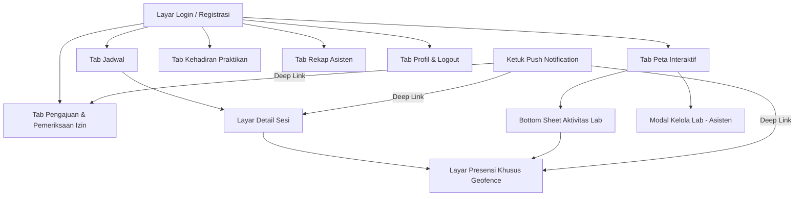

# Navigasi, Layar, dan Spesifikasi UI — Sprint 3

Dokumen ini mendefinisikan rute Expo Router baru, struktur navigasi, spesifikasi antarmuka visual, dan penanganan kondisi error UI untuk fitur Geolocation, Peta Interaktif, dan Push Notification pada **Sprint 3**.

---

## 1. Peta Navigasi Aplikasi

### Rincian Rute Expo Router
| Rute | File | Tipe | Akses Peran | Keterangan |
| --- | --- | --- | --- | --- |
| `/` | `src/app/index.tsx` | Stack Entry | Publik | Splash & gerbang login/registrasi |
| `/(tabs)/jadwal` | `src/app/(tabs)/jadwal.tsx` | Tab Screen | Semua | Jadwal sesi praktikum aktif |
| `/(tabs)/peta` | `src/app/(tabs)/peta.tsx` | Tab Screen | Semua | **(Baru)** Peta persebaran laboratorium interaktif |
| `/(tabs)/kehadiran` | `src/app/(tabs)/kehadiran.tsx` | Tab Screen | Praktikan | Riwayat kehadiran praktikan |
| `/(tabs)/rekap` | `src/app/(tabs)/rekap.tsx` | Tab Screen | Asisten | Rekapitulasi kehadiran praktikum |
| `/(tabs)/izin` | `src/app/(tabs)/izin.tsx` | Tab Screen | Semua | Pengajuan izin & pemeriksaan asisten |
| `/(tabs)/profil` | `src/app/(tabs)/profil.tsx` | Tab Screen | Semua | Profil pengguna & tombol logout |
| `/sesi/[sesiId]` | `src/app/sesi/[sesiId].tsx` | Stack Screen | Semua | Detail sesi praktikum |
| `/presensi/[sesiId]` | `src/app/presensi/[sesiId].tsx` | Stack Screen | Praktikan | **(Baru)** Layar presensi khusus validasi geofence |

---

## 2. Spesifikasi Layar 1: Halaman Presensi Khusus (`/presensi/[sesiId]`)

Layar khusus yang didedikasikan untuk pencatatan kehadiran praktikan dengan verifikasi lokasi GPS.

### Struktur UI
1. **Header Sesi**:
   - Judul praktikum, kelas, ruang laboratorium, dan nama asisten bertugas.
   - Status sesi saat ini: Badge hijau *"Sesi Dibuka"* atau Badge abu-abu *"Sesi Ditutup"*.
2. **Kartu Validasi Geofence (Location Status Card)**:
   - **Indikator Radar / Ikon Status**: Visual status geofence (Centang Hijau jika dalam radius; Silang Merah jika luar radius).
   - **Metrik Jarak**: Menampilkan teks informatif: *"Jarak Anda ke [Nama Lab]: 14 meter (Maksimal: 30 meter)"*.
   - **Tingkat Akurasi GPS**: Menampilkan indikator akurasi sinyal (misal: *"Akurasi GPS: 8 meter — Sangat Baik"*).
   - **Tombol Segarkan Lokasi**: Tombol untuk memicu pemindaian ulang koordinat GPS secara manual jika sinyal sempat melemah.
3. **Form Catatan Presensi**:
   - Kolom teks opsional untuk catatan praktikan (maksimal 120 karakter).
4. **Tombol Aksi Utama**:
   - Label: *"Kirim Presensi Kehadiran"*.
   - Status tombol: Aktif hanya jika `statusSesi === 'open'` **DAN** `statusGeofence === 'DALAM_RADIUS'`.
   - Menampilkan loading spinner saat pengiriman presensi ke Firestore.
5. **(Fitur Opsional) Opsi Scan QR Code**:
   - Jika praktikan mengalami kendala GPS di dalam ruangan berbeton tebal, asisten dapat menampilkan QR Code sesi dan praktikan menekan tombol *"Gunakan Scan QR Asisten"*.

---

## 3. Spesifikasi Layar 2: Peta Laboratorium Interaktif (`/(tabs)/peta`)

Layar visual yang menyajikan persebaran laboratorium di lingkungan Informatika berbasis Google Maps.

### Struktur UI
1. **Peta Layar Penuh (`MapView`)**:
   - Menampilkan peta wilayah kampus / gedung Informatika.
   - Kontrol gestur sentuh (pan, zoom, rotate, tilt) halus.
2. **Visualisasi Marker**:
   - **Marker Laboratorium**: Pin custom bergambar komputer/lab dengan label nama singkatan (misal: `LAB-AI`, `LAB-RPL`). Warna hijau menyala jika terdapat praktikum aktif, warna netral jika kosong.
   - **Lingkaran Geofence (`Circle Overlay`)**: Lingkaran transparan warna hijau muda di sekeliling marker lab dengan jari-jari sesuai `radiusMeters`.
   - **Marker Posisi Pengguna**: Titik biru berdenyut (*pulsing blue dot*) yang menunjukkan posisi terkini pengguna secara real-time.
3. **Floating Action Buttons (FAB)**:
   - **Tombol Recenter**: Ikon target/kompas untuk memusatkan kembali kamera peta ke posisi pengguna.
   - **Tombol Kelola Lab (Khusus Asisten)**: Ikon edit/plus untuk membuka modal pengelolaan data dan koordinat lab.

---

## 4. Spesifikasi Layar 3: Bottom Sheet Aktivitas Laboratorium

Panel geser yang muncul dari bawah layar ketika salah satu marker laboratorium di peta diketuk oleh pengguna.

### Struktur UI
1. **Informasi Utama Laboratorium**:
   - Nama lengkap lab, lokasi gedung dan lantai, kapasitas ruangan, dan radius geofence.
2. **Bagian Praktikum Berlangsung (Ongoing Session)**:
   - Jika ada sesi aktif: Menampilkan kartu berwarna hijau dengan nama mata kuliah, kelas, topik sesi, jam mulai-selesai, asisten, dan badge status `Dibuka`.
   - Bagi praktikan anggota kelas tersebut, terdapat tombol cepat: *"Masuk Halaman Presensi"*.
   - Jika tidak ada: Tampil keterangan *"Tidak ada praktikum aktif saat ini"*.
3. **Bagian Jadwal Praktikum Berikutnya (Upcoming Sessions)**:
   - Daftar 1–3 kartu jadwal sesi mendatang pada hari tersebut atau hari berikutnya.
   - Menampilkan topik praktikum, kelas, dan estimasi waktu pelaksanaan.
4. **Tombol Tutup / Geser Turun**: Menutup bottom sheet untuk kembali ke eksplorasi peta.

---

## 5. Spesifikasi Layar 4: Modal Pengelolaan Laboratorium (Khusus Asisten)

Formulir bagi asisten untuk mengatur data fisik dan batas toleransi geofence laboratorium.

### Struktur UI
1. **Form Input Data**:
   - Nama Laboratorium (string wajib).
   - Kode Singkat (misal: "LAB-AI").
   - Gedung & Lantai (string wajib).
   - Latitude (angka pecahan, tombol *"Gunakan Lokasi Saat Ini"* untuk mengisi otomatis koordinat asisten di ruangan tersebut).
   - Longitude (angka pecahan).
   - Radius Toleransi Geofence (slider / input angka 10 s/d 500 meter, default 30 meter).
2. **Pratinjau Peta Mini**:
   - Menampilkan posisi pin dan lingkaran radius yang sedang diatur sebelum disimpan.
3. **Aksi Simpan**:
   - Validasi batas nilai koordinat dan radius.
   - Menyimpan ke Firestore koleksi `laboratories`.

---

## 6. Penanganan Kondisi Error dan State UI Defensif

| Kondisi | Penanganan Tampilan (UI State) | Solusi yang Diberikan ke Pengguna |
| --- | --- | --- |
| **Izin Lokasi Ditolak** | Banner peringatan merah (*danger*): *"Izin lokasi ditolak. Aplikasi membutuhkan akses lokasi untuk memvalidasi presensi di lab."* | Tombol *"Buka Pengaturan Aplikasi"* untuk mengarahkan pengguna ke setting OS. |
| **Layanan GPS Mati** | Dialog pop-up / banner oranye (*warning*): *"Layanan lokasi (GPS) perangkat Anda nonaktif."* | Tombol *"Aktifkan GPS"* atau instruksi menyalakan GPS di quick settings ponsel. |
| **Sinyal GPS Lemah (Akurasi Rendah)** | Indikator kuning memuat: *"Mencari sinyal GPS akurat (Akurasi saat ini: >50m)..."* | Meminta praktikan bergerak dekat jendela/pintu lab dan tombol *"Segarkan Lokasi"*. |
| **Di Luar Radius Lab** | Kartu status merah: *"Anda berada di luar radius laboratorium. Jarak: 85 meter (Batas: 30 meter)."* | Tombol presensi dinonaktifkan (*disabled*) dan petunjuk untuk mendekati ruangan lab. |
| **Sesi Belum Dibuka / Selesai** | Kartu status abu-abu: *"Sesi praktikum belum dibuka oleh asisten."* | Tombol presensi dinonaktifkan, auto-update saat asisten membuka sesi via Firestore listener. |
| **Izin Notifikasi Ditolak** | Banner info di tab Profil: *"Pemberitahuan push nonaktif. Anda mungkin melewatkan info sesi dibuka."* | Tombol *"Izinkan Pemberitahuan"* untuk memicu dialog izin sistem operasi. |
