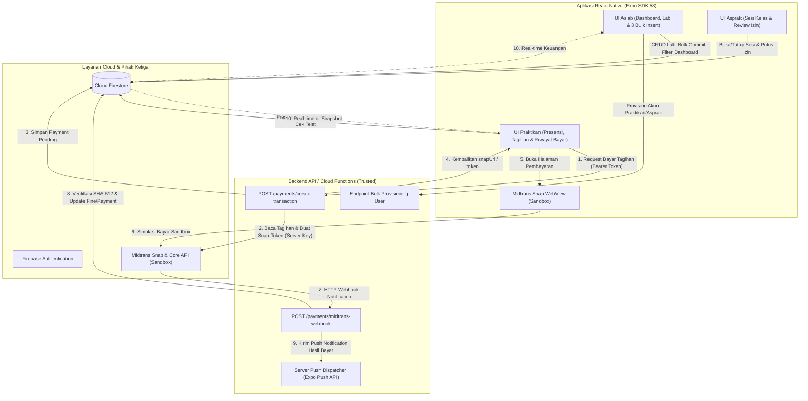
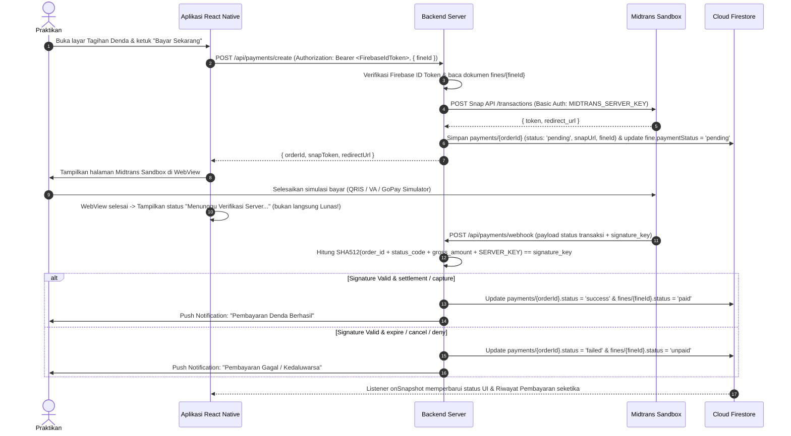

# Arsitektur Sistem: Multi-Role (Aslab/Asprak), Bulk Engine, Denda, & Midtrans Webhook — Sprint 4

Dokumen ini mendefinisikan arsitektur teknis **Sprint 4** yang memperluas fondasi klien-Firestore dari Sprint 1–3 menjadi arsitektur hibrida **Client – Backend API – Midtrans Sandbox – Cloud Firestore** dengan tiga peran pengguna terisolasi.

---

## 1. Inspeksi Codebase Aktual (Baseline Akhir Sprint 3)

Tabel berikut memetakan modul yang **sudah berjalan** di repositori saat ini beserta perubahan arsitektural yang dibutuhkan untuk Sprint 4:

| Modul Eksisting | Lokasi File Saat Ini | Status Implementasi | Ekstensi / Perubahan di Sprint 4 |
| --- | --- | --- | --- |
| **Autentikasi & Profil** | `src/contexts/AuthContext.tsx`, `src/services/authService.ts` | Mendukung `'praktikan' \| 'asisten'` | Memperluas tipe `Role` menjadi `'praktikan' \| 'asprak' \| 'aslab'` (dengan fallback kompatibilitas `'asisten'` $\rightarrow$ `'asprak'`) serta memuat daftar `managedCourseIds` (Aslab) / `assignedLabIds` (Asprak). |
| **Manajemen Praktikum & Sesi** | `src/services/practicumService.ts`, `src/store/app-context.tsx` | CRUD kelas, peserta single, jadwal, sesi, & status buka/tutup untuk semua `asisten` | Membatasi query `asprak` hanya pada lab/kelas tanggung jawabnya; memindahkan mutasi kelas/lab & distribusi peserta/asprak ke layanan khusus `aslab`. |
| **Peta & Master Lab** | `src/services/maps/laboratoryService.ts`, `src/features/maps/` | Peta Leaflet (`react-native-webview`), marker geofence, sheet aktivitas, single CRUD lab | Menambahkan field `courseId`, `gracePeriodMinutes`, dan `lateFineAmount` pada lab; mengunci modal kelola lab khusus untuk `aslab`; memperluas agregator aktivitas untuk Dashboard Aslab. |
| **Presensi Geofence** | `src/services/attendanceService.ts`, `src/features/presensi/` | Validasi Haversine & catat `status: 'hadir'` di subkoleksi `attendances` | Menambahkan kalkulator *grace period* dalam transaksi presensi: menandai `lateStatus: 'on_time' \| 'late'`, menghitung `lateMinutes`, dan menulis dokumen tagihan `fines/{sessionId}_{uid}` secara atomik jika terlambat. |
| **Perizinan & AI Lokal** | `src/services/permissionService.ts`, `src/features/permissions/` | Pengajuan izin, klasifikasi sentimen lokal, keputusan `approved`/`rejected` | Mengintegrasikan status `approved` ke selector kehadiran sebagai `izin` (*excused absence*) bebas denda (dan membatalkan tagihan belum lunas pada sesi terkait bila ada). |
| **Push Notification** | `src/services/notifications/notificationDispatcher.ts` | Expo Push API + audit `notifications` untuk 3 event (`session_opened`, `schedule_changed`, `leave_decided`) | Menambahkan 3 event baru (`fine_created`, `payment_success`, `payment_failed`) beserta deep link ke layar Tagihan / Riwayat Pembayaran; pengiriman status bayar dipicu dari backend webhook. |
| **Backend Server** | *(Belum ada di repo)* | Aplikasi masih 100% client-side | Menambahkan direktori `backend/` (Cloud Functions / Node Serverless API) dengan `firebase-admin` untuk provisioning bulk user, pembuatan transaksi Midtrans Snap, dan endpoint webhook verifikasi pembayaran. |

---

## 2. Diagram Arsitektur Sistem Sprint 4



---

## 3. Desain Pipeline 3 Bulk Insert Terpisah & Interactive `ScrollView`

Sesuai kebutuhan PRD Poin 1, ketiga fitur bulk insert **dipisahkan menjadi 3 alur independen** agar skema validasi tidak tercampur:
1. **Bulk Insert Laboratorium** (konteks: 1 Mata Kuliah dipilih terlebih dahulu).
2. **Bulk Insert Praktikan** (konteks: 1 Laboratorium tujuan dipilih terlebih dahulu).
3. **Bulk Insert Asprak** (konteks: 1 Laboratorium tujuan dipilih terlebih dahulu).

### Alur Kerja Bulk Insert di Klien:
```text
[1. Unduh Template CSV]
   └── Generator lokal menulis header + 2 baris contoh ke file sementara (expo-file-system)
   └── Membuka dialog simpan/bagikan OS (expo-sharing / anchor download di web)

[2. Pilih & Parse File CSV]
   └── Pengguna memilih file .csv melalui Document Picker
   └── Parser CSV memetakan tiap baris ke state draft: BulkRowDraft<T>[]
         { rowId, decision: 'accept' | 'deny', values: {...}, missingFields: [...], errors: [...] }

[3. Pratinjau & Editor Fleksibel di ScrollView]
   └── Setiap row dirender sebagai kartu interaktif di dalam ScrollView:
         ├── Toggle Accept / Deny (baris 'deny' dilewati saat penyimpanan)
         ├── Input teks inline untuk mengedit data atau mengisi kolom yang masih kosong
         └── Badge indikator validasi real-time ("Siap Disimpan" vs "Data Belum Lengkap")

[4. Eksekusi Batch Commit]
   └── Hanya baris berstatus 'accept' dan lolos validasi yang diproses
   └── Untuk Praktikan/Asprak: memanggil resolver akun (mencocokkan UID eksisting / provision via backend)
   └── Menyimpan ke Firestore secara atomik menggunakan writeBatch
```

---

## 4. Mesin Perhitungan Keterlambatan (*Grace Period*) & *Excused Absence*

### A. Formula Evaluasi Ketepatan Waktu
Saat praktikan mengirim presensi yang lolos geofence pada sesi berstatus `open`:
1. Tentukan waktu mulai acuan sesi:
   $$\text{effectiveStartMs} = \max(\text{scheduledStartMs}, \text{sessionOpenedAtMs})$$
2. Hitung batas akhir masa toleransi (*grace period*):
   $$\text{graceDeadlineMs} = \text{effectiveStartMs} + (\text{gracePeriodMinutes} \times 60.000)$$
3. Bandingkan waktu pencatatan presensi ($\text{recordedAtMs}$):
   - **Tepat Waktu**: Jika $\text{recordedAtMs} \le \text{graceDeadlineMs}$, maka:
     - `lateStatus = 'on_time'`, `lateMinutes = 0`
     - Tidak ada dokumen tagihan yang dibuat.
   - **Terlambat**: Jika $\text{recordedAtMs} > \text{graceDeadlineMs}$, maka:
     - `lateStatus = 'late'`
     - $\text{lateMinutes} = \lceil (\text{recordedAtMs} - \text{graceDeadlineMs}) / 60.000 \rceil$
     - Dalam transaksi Firestore yang sama (`runTransaction`), sistem membuat dokumen tagihan deterministik `fines/{sessionId}_{uid}` (jika belum ada) dengan `amount = session.lateFineAmount` dan `status = 'unpaid'`, lalu memicu notifikasi `fine_created`.

### B. Integrasi Keputusan Izin (*Excused Absence*)
- Ketika Asprak menyetujui pengajuan izin (`leaveRequests.status = 'approved'`):
  1. Sistem **tidak pernah** membuat dokumen di `sessions/{sessionId}/attendances/{uid}` sehingga catatan kehadiran tidak berubah menjadi hadir.
  2. Selector riwayat kehadiran (`selectRiwayatPraktikan` & rekap sesi) memeriksa daftar `leaveRequests` yang `approved`: jika praktikan tidak memiliki presensi namun memiliki izin `approved` pada sesi tersebut, status ditampilkan sebagai **`izin` (*Tidak Hadir dengan Izin / Excused Absence*)**.
  3. Apabila karena kondisi balapan (*race condition*) terdapat tagihan keterlambatan berstatus `unpaid` pada sesi tersebut, keputusan `approved` menandai tagihan tersebut menjadi `waived` (dibebaskan) sehingga nominal tagihan aktif menjadi `Rp0`.

---

## 5. Alur Sekuens Pembayaran Midtrans Sandbox & Verifikasi Webhook



### Pemetaan Status Midtrans ke Status Aplikasi
| `transaction_status` Midtrans | `fraud_status` | Status Aplikasi (`PaymentStatus`) | Efek pada Dokumen `fines/{fineId}` | Notifikasi Dipicu |
| --- | --- | --- | --- | --- |
| `capture` | `accept` | `success` | `status = 'paid'`, `paidAt = serverTimestamp()` | `payment_success` |
| `settlement` | *(any)* | `success` | `status = 'paid'`, `paidAt = serverTimestamp()` | `payment_success` |
| `pending` | *(any)* | `pending` | `status = 'pending_payment'` | `payment_pending` *(jika butuh tindak lanjut)* |
| `deny` / `cancel` / `expire` / `failure` | *(any)* | `failed` | `status = 'unpaid'` (dapat dibayar ulang) | `payment_failed` |

---

## 6. Desain Agregasi & Filter Dashboard Aslab

Untuk memenuhi kebutuhan filter **Hari**, **Minggu**, dan **Bulan** tanpa membebani kuota baca berlebih:
1. Rentang waktu filter dihitung secara deterministik pada zona waktu lokal:
   - **Hari Ini (`day`)**: `00:00:00.000` s/d `23:59:59.999` pada tanggal terpilih.
   - **Minggu Ini (`week`)**: Senin `00:00:00` s/d Minggu `23:59:59` pada pekan berjalan.
   - **Bulan Ini (`month`)**: Tanggal 1 `00:00:00` s/d akhir bulan `23:59:59`.
2. Layanan `aslabDashboardService.ts` menggabungkan snapshot real-time dari:
   - `laboratories` & `classMembers` yang berada di bawah `courseId` tanggung jawab Aslab $\rightarrow$ menghasilkan total lab, total praktikan, dan kapasitas per lab.
   - `sessions` & `schedules` yang difilter berdasarkan rentang waktu $\rightarrow$ dikelompokkan menjadi **Sedang Berlangsung**, **Akan Datang**, dan **Riwayat Selesai**.
   - `fines` & `payments` pada lab terkait yang difilter berdasarkan rentang waktu transaksi/tagihan $\rightarrow$ menghasilkan metrik **Total Denda Lunas (`Rp`)**, **Total Denda Belum Lunas (`Rp`)**, dan daftar riwayat keuangan.

---

## 7. Struktur Direktori Baru & Diperbarui di Sprint 4

```text
ppk-rn-expo-58/
├── backend/                                    # (Baru) Layanan Server Midtrans & Admin Provisioning
│   ├── package.json
│   ├── .env.example                            # MIDTRANS_SERVER_KEY, MIDTRANS_IS_PRODUCTION=false, FIREBASE_SERVICE_ACCOUNT
│   └── src/
│       ├── index.ts                            # Entry server / Cloud Functions export
│       ├── middleware/verifyFirebaseToken.ts   # Validasi Bearer ID Token dari aplikasi RN
│       ├── routes/payments.ts                  # Create Snap transaction & Midtrans webhook handler
│       ├── routes/provisioning.ts              # Admin provisioning akun praktikan/asprak untuk bulk insert
│       └── services/midtransSignature.ts       # Kalkulasi & verifikasi SHA-512 signature_key
│
├── src/
│   ├── app/
│   │   ├── (tabs)/
│   │   │   ├── _layout.tsx                     # Diperbarui: Tab dinamis 3 peran (praktikan, asprak, aslab)
│   │   │   ├── dashboard.tsx                   # (Baru) Tab Dashboard Keberlangsungan & Keuangan Aslab
│   │   │   ├── kelola-lab.tsx                  # (Baru) Tab Manajemen Lab, Bulk Insert & Transfer (Aslab)
│   │   │   └── denda.tsx                       # (Baru) Tab Tagihan Denda & Riwayat Pembayaran (Praktikan)
│   │   └── pembayaran/
│   │       └── [fineId].tsx                    # (Baru) Layar Checkout Midtrans Snap WebView & Status Verifikasi
│   │
│   ├── features/
│   │   ├── aslab/
│   │   │   ├── AslabDashboardScreen.tsx        # Dashboard metrik lab, kegiatan, keuangan + filter hari/minggu/bulan
│   │   │   ├── LabManagementScreen.tsx         # Daftar lab per matkul, form radius & batas keterlambatan
│   │   │   ├── BulkInsertModal.tsx             # 3 mode terpisah (Lab, Praktikan, Asprak) + unduh template CSV
│   │   │   ├── BulkPreviewScrollList.tsx       # ScrollView interaktif (accept/deny, inline edit, isi kosong)
│   │   │   └── MemberTransferModal.tsx         # Pindah praktikan / asprak antar laboratorium
│   │   │
│   │   └── payments/
│   │       ├── PraktikanFinesScreen.tsx        # Daftar tagihan denda aktif & tab riwayat pembayaran persisten
│   │       ├── PaymentCheckoutScreen.tsx       # Integrasi Snap WebView & pantauan status real-time
│   │       └── PaymentHistoryList.tsx          # Komponen daftar transaksi (sesi, tgl, nominal, waktu, status)
│   │
│   ├── services/
│   │   ├── aslab/
│   │   │   ├── bulkTemplateService.ts          # Generator & parser CSV untuk 3 template terpisah
│   │   │   ├── labDistributionService.ts       # Batch insert lab/praktikan/asprak & transfer antar lab
│   │   │   └── aslabDashboardService.ts        # Agregasi kegiatan & keuangan berfilter hari/minggu/bulan
│   │   ├── fines/
│   │   │   └── fineCalculationService.ts       # Kalkulasi grace period, lateMinutes, & excused absence
│   │   └── payments/
│   │       └── paymentService.ts               # Client caller ke backend create-transaction & Firestore listeners
│   │
│   └── types/
│       ├── fine.ts                             # Tipe FineRecord, LateEvaluationResult, FinePolicy
│       └── payment.ts                          # Tipe PaymentTransaction, PaymentStatus, SnapCreateResponse
```
