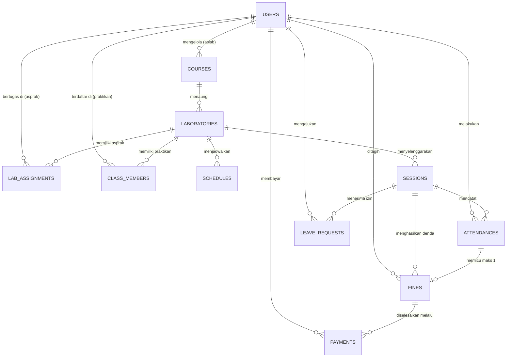

# Data Model, Kontrak Firestore, Format CSV Bulk, dan Security Rules — Sprint 4

Dokumen ini mendefinisikan skema data Cloud Firestore, format ketiga template bulk insert, kontrak payload webhook Midtrans, dan pembaruan Security Rules untuk **Sprint 4** di atas skema Sprint 3.

---

## 1. Entity Relationship Diagram (ERD) Sprint 4



---

## 2. Rancangan Koleksi Firestore Baru dan Diperbarui

### A. Pembaruan Koleksi: `users/{uid}`
Memperluas peran dari 2 menjadi 3 peran terpisah dengan kompatibilitas mundur terhadap data lama.

| Field | Tipe | Keterangan |
| --- | --- | --- |
| `uid` | `string` | Firebase Auth UID |
| `email` | `string` | Alamat email akun |
| `nama` | `string` | Nama lengkap pengguna |
| `role` | `string` | `'praktikan'` \| `'asprak'` \| `'aslab'` *(nilai lama `'asisten'` dibaca aplikasi sebagai `'asprak'`)* |
| `nim` | `string \| null` | Nomor Induk Mahasiswa (praktikan / asisten mahasiswa) |
| `nip` | `string \| null` | Nomor Induk / identitas asisten |
| `managedCourseIds` | `string[]` | *(Khusus `aslab`)* Daftar ID mata kuliah yang menjadi tanggung jawabnya |

---

### B. Koleksi Baru: `courses/{courseId}` (Mata Kuliah Praktikum)
Menggantikan `praktikumId` statis agar Aslab dapat mengelola laboratorium berdasarkan mata kuliah tanggung jawabnya.

| Field | Tipe | Keterangan |
| --- | --- | --- |
| `id` | `string` | ID unik mata kuliah (misal: `praktikum-ppk`, `praktikum-bd`) |
| `kode` | `string` | Kode mata kuliah (misal: `IF2104`) |
| `nama` | `string` | Nama mata kuliah (misal: `Praktikum Pemrograman Komputer`) |
| `aslabUids` | `string[]` | Daftar UID Aslab penanggung jawab mata kuliah ini |
| `defaultGracePeriodMinutes` | `number` | Default toleransi keterlambatan dalam menit (misal: `15`) |
| `defaultLateFineAmount` | `number` | Default nominal tetap denda dalam Rupiah (misal: `10000`) |
| `aktif` | `boolean` | Status keaktifan mata kuliah |

---

### C. Pembaruan Koleksi: `laboratories/{labId}` (Selaras dengan Unit Kelas Lab)
Memperluas skema `laboratories` Sprint 3 agar mencakup relasi mata kuliah, cakupan lokasi presensi, dan kebijakan keterlambatan/denda. Untuk menjaga kompatibilitas penuh dengan fitur Sesi & Izin Sprint 2–3, setiap unit laboratorium disinkronkan 1-to-1 dengan `classes/{labId}`.

| Field | Tipe | Status | Keterangan |
| --- | --- | --- | --- |
| `id` | `string` | Eksisting | ID unik laboratorium (sekaligus `classId` kompatibel) |
| `courseId` | `string` | **Baru** | ID mata kuliah induk (`courses/{courseId}`) |
| `courseNama` | `string` | **Baru** | Snapshot nama mata kuliah |
| `nama` | `string` | Eksisting | Nama laboratorium/kelas lab (misal: `"Lab PPK - A"`) |
| `kode` | `string` | Eksisting | Kode singkat lab (misal: `"PPK-A"`) |
| `gedung` | `string` | Eksisting | Informasi lokasi gedung & ruangan (misal: `"Gedung F Lt. 3 R.302"`) |
| `latitude` | `number` | Eksisting | Koordinat lintang (`-90.0` s/d `90.0`) |
| `longitude` | `number` | Eksisting | Koordinat bujur (`-180.0` s/d `180.0`) |
| `radiusMeters` | `number` | Eksisting | Cakupan radius lokasi presensi (`10` s/d `500` meter) |
| `gracePeriodMinutes` | `number` | **Baru** | Batasan toleransi keterlambatan waktu dalam menit (`0` s/d `120`, default `15`) |
| `lateFineAmount` | `number` | **Baru** | Nominal tetap denda keterlambatan dalam Rupiah (misal: `10000`, minimal `1000`) |
| `kapasitas` | `number` | Eksisting | Kapasitas maksimal praktikan |
| `asprakUids` | `string[]` | **Baru** | Ringkasan UID Asprak aktif untuk pemfilteran cepat `array-contains` |
| `aktif` | `boolean` | Eksisting | Status aktif (`true` / `false`) |
| `updatedBy` | `string` | **Baru** | UID Aslab terakhir yang memperbarui |
| `updatedAt` | `timestamp` | Eksisting | Waktu server pembaruan |

---

### D. Koleksi Baru: `labAssignments/{labId}_{uid}` (Distribusi Asprak ke Lab)
Menyimpan penugasan Asprak pada laboratorium tertentu (analog dengan `classMembers/{classId}_{uid}` milik praktikan).

| Field | Tipe | Keterangan |
| --- | --- | --- |
| `labId` | `string` | ID laboratorium (sekaligus `classId`) |
| `courseId` | `string` | ID mata kuliah terkait |
| `uid` | `string` | UID akun `asprak` |
| `nama` | `string` | Nama lengkap Asprak |
| `nip` | `string` | NIP / NIM identitas Asprak |
| `email` | `string` | Email akun Asprak |
| `active` | `boolean` | `true` jika masih bertugas di lab ini; `false` jika sudah dipindahkan/dinonaktifkan |
| `assignedBy` | `string` | UID Aslab yang menugaskan/memindahkan |
| `createdAt` | `timestamp` | Waktu penugasan awal |
| `updatedAt` | `timestamp` | Waktu pembaruan terakhir |

---

### E. Pembaruan Koleksi `sessions/{sessionId}` & Subkoleksi `attendances/{uid}`

**Tambahan field pada `sessions/{sessionId}`**:
- `courseId`: `string` — relasi mata kuliah untuk agregasi Dashboard Aslab.
- `gracePeriodMinutes`: `number` — snapshot batas toleransi keterlambatan yang berlaku pada sesi ini.
- `lateFineAmount`: `number` — snapshot nominal tetap denda yang berlaku pada sesi ini.

**Tambahan field pada `sessions/{sessionId}/attendances/{uid}`**:
- `lateStatus`: `'on_time' | 'late'` — hasil perhitungan terhadap akhir masa *grace period*.
- `lateMinutes`: `number` — selisih menit melewati *grace period* (`0` jika tepat waktu).
- `graceDeadlineAt`: `string` — ISO timestamp batas akhir toleransi sesi saat presensi dievaluasi.
- `fineId`: `string | null` — referensi deterministik `"{sessionId}_{uid}"` jika `lateStatus == 'late'`, selain itu `null`.

---

### F. Koleksi Baru: `fines/{fineId}` (Tagihan Denda Keterlambatan)
Menggunakan **ID dokumen deterministik `{sessionId}_{uid}`** sehingga secara struktural mustahil satu kejadian keterlambatan menghasilkan lebih dari satu tagihan.

| Field | Tipe | Keterangan |
| --- | --- | --- |
| `id` | `string` | Deterministik: `{sessionId}_{uid}` |
| `uid` | `string` | UID praktikan tertagih |
| `praktikanNama` | `string` | Snapshot nama praktikan |
| `praktikanNim` | `string` | Snapshot NIM praktikan |
| `courseId` | `string` | ID mata kuliah |
| `labId` | `string` | ID laboratorium / kelas |
| `labNama` | `string` | Snapshot nama laboratorium |
| `sessionId` | `string` | ID sesi praktikum terkait |
| `sessionTopik` | `string` | Snapshot topik sesi |
| `sessionTanggal` | `string` | Tanggal sesi (`YYYY-MM-DD`) |
| `attendanceId` | `string` | Referensi ke `sessions/{sessionId}/attendances/{uid}` |
| `waktuPresensi` | `string` | Waktu presensi tercatat (ISO 8601) |
| `lateMinutes` | `number` | Durasi keterlambatan melewati *grace period* (menit) |
| `amount` | `number` | Nominal tetap denda dalam Rupiah (misal: `10000`) |
| `status` | `string` | `'unpaid'` \| `'pending_payment'` \| `'paid'` \| `'waived'` |
| `latestOrderId` | `string \| null` | `order_id` transaksi Midtrans terbaru |
| `paidAt` | `timestamp \| null` | Waktu pelunasan terverifikasi webhook |
| `createdAt` | `timestamp` | Waktu tagihan dibuat |
| `updatedAt` | `timestamp` | Waktu pembaruan terakhir |

> **Invarian Penting**: Saat `fines/{fineId}.status` berubah menjadi `'paid'`, dokumen `sessions/{sessionId}/attendances/{uid}` **sama sekali tidak dimodifikasi** (tetap `status: 'hadir'`, `lateStatus: 'late'`).

---

### G. Koleksi Baru: `payments/{orderId}` (Transaksi & Riwayat Pembayaran Midtrans)
Menyimpan seluruh percobaan dan hasil transaksi pembayaran Midtrans Sandbox untuk keperluan verifikasi webhook, halaman Riwayat Pembayaran praktikan, serta Riwayat Keuangan di Dashboard Aslab.

| Field | Tipe | Keterangan |
| --- | --- | --- |
| `orderId` | `string` | ID unik transaksi Midtrans (misal: `FINE-{sessionId}-{uidShort}-{timestamp}`) |
| `fineId` | `string` | Relasi ke `fines/{fineId}` |
| `uid` | `string` | UID praktikan pembayar |
| `praktikanNama` | `string` | Snapshot nama praktikan |
| `courseId` | `string` | ID mata kuliah (untuk filter keuangan Aslab) |
| `labId` | `string` | ID laboratorium (untuk filter keuangan Aslab) |
| `labNama` | `string` | Snapshot nama laboratorium |
| `sessionId` | `string` | ID sesi terkait |
| `sessionTopik` | `string` | Snapshot topik sesi |
| `fineCreatedAt` | `string` | Tanggal tagihan awal dibuat |
| `grossAmount` | `number` | Nominal transaksi dalam Rupiah |
| `status` | `string` | `'pending'` \| `'success'` \| `'failed'` |
| `paymentType` | `string \| null` | Metode bayar dari Midtrans (misal: `'qris'`, `'bank_transfer'`, `'gopay'`) |
| `snapToken` | `string` | Token Snap Midtrans Sandbox |
| `redirectUrl` | `string` | URL halaman pembayaran Snap Midtrans Sandbox |
| `midtransTransactionId` | `string \| null` | `transaction_id` dari callback Midtrans |
| `midtransTransactionStatus` | `string \| null` | Status mentah Midtrans (`settlement`, `pending`, `expire`, dll.) |
| `transactionTime` | `string \| null` | Waktu transaksi dari Midtrans / server |
| `settledAt` | `timestamp \| null` | Waktu konfirmasi sukses oleh backend webhook |
| `createdAt` | `timestamp` | Waktu pembuatan transaksi di backend |
| `updatedAt` | `timestamp` | Waktu pembaruan terakhir oleh backend |

---

### H. Pembaruan Koleksi: `notifications/{notificationId}`
Memperluas `type` dan `data.screen` untuk mengakomodasi peristiwa pembayaran Sprint 4:
- `type` diperluas menjadi:
  - `'session_opened'` | `'schedule_changed'` | `'leave_decided'` *(Sprint 3)*
  - `'fine_created'` | `'payment_success'` | `'payment_failed'` *(Baru di Sprint 4)*
- `data.screen` diperluas dengan `'denda'` dan `'pembayaran'` (beserta `fineId` dan `orderId` opsional).

---

## 3. Spesifikasi 3 File Template CSV Bulk Insert (Terpisah)

Ketiga template disediakan sebagai file `.csv` terpisah yang dapat diunduh dari aplikasi:

### 1. `template-bulk-laboratorium.csv` (Berdasarkan 1 Mata Kuliah Terpilih)
```csv
nama,kode,gedung,latitude,longitude,radiusMeters,gracePeriodMinutes,lateFineAmount,kapasitas
Lab PPK A,PPK-A,Gedung F Lt. 3 R.301,-7.952640,112.614420,30,15,10000,35
Lab PPK B,PPK-B,Gedung F Lt. 3 R.302,-7.952710,112.614510,30,15,10000,35
```

### 2. `template-bulk-praktikan.csv` (Ke 1 Laboratorium Tertentu)
```csv
nim,nama,email
245150200111001,Andi Pratama,andi.pratama@student.ac.id
245150200111002,Siti Rahmawati,siti.rahma@student.ac.id
```

### 3. `template-bulk-asprak.csv` (Ke 1 Laboratorium Tertentu)
```csv
nip,nama,email
225150200111010,Rina Kusuma,rina.asprak@student.ac.id
225150200111015,Doni Saputra,doni.asprak@student.ac.id
```

---

## 4. Rancangan Pembaruan Firebase Security Rules (Sprint 4)

```javascript
rules_version = '2';
service cloud.firestore {
  match /databases/{database}/documents {

    function isSignedIn() {
      return request.auth != null;
    }

    function profilSaya() {
      return get(/databases/$(database)/documents/users/$(request.auth.uid)).data;
    }

    function isPraktikan() {
      return isSignedIn() && profilSaya().role == 'praktikan';
    }

    // Kompatibel mundur: dokumen lama dengan role 'asisten' diperlakukan sebagai 'asprak'
    function isAsprak() {
      return isSignedIn() && (profilSaya().role == 'asprak' || profilSaya().role == 'asisten');
    }

    function isAslab() {
      return isSignedIn() && profilSaya().role == 'aslab';
    }

    function isAssignedAsprak(labId) {
      return isAsprak()
        && exists(/databases/$(database)/documents/labAssignments/$(labId + '_' + request.auth.uid))
        && get(/databases/$(database)/documents/labAssignments/$(labId + '_' + request.auth.uid)).data.active == true;
    }

    // --- LABORATORIUM & KELAS: Konfigurasi penuh hanya oleh Aslab ---
    match /laboratories/{labId} {
      allow read: if isSignedIn();
      allow create, update: if isAslab()
        && request.resource.data.latitude >= -90.0 && request.resource.data.latitude <= 90.0
        && request.resource.data.longitude >= -180.0 && request.resource.data.longitude <= 180.0
        && request.resource.data.radiusMeters >= 10 && request.resource.data.radiusMeters <= 500
        && request.resource.data.gracePeriodMinutes >= 0 && request.resource.data.gracePeriodMinutes <= 120
        && request.resource.data.lateFineAmount >= 0;
      allow delete: if false;
    }

    // --- DISTRIBUSI ASPRAK & PRAKTIKAN: Hanya dikelola oleh Aslab ---
    match /labAssignments/{assignmentId} {
      allow read: if isAslab() || (isAsprak() && resource.data.uid == request.auth.uid);
      allow create, update: if isAslab();
      allow delete: if false;
    }

    // --- TAGIHAN DENDA (FINES) ---
    // Dibuat 1x saat praktikan presensi terlambat (ID = {sessionId}_{uid}).
    // Status 'paid' TIDAK BOLEH ditulis dari klien; hanya Backend Admin SDK yang boleh melunasi!
    match /fines/{fineId} {
      allow read: if isAslab()
        || (isPraktikan() && resource.data.uid == request.auth.uid)
        || (isAsprak() && isAssignedAsprak(resource.data.labId));

      allow create: if isPraktikan()
        && request.resource.data.uid == request.auth.uid
        && fineId == request.resource.data.sessionId + '_' + request.auth.uid
        && request.resource.data.status == 'unpaid'
        && request.resource.data.amount > 0;

      // Asprak/Aslab hanya boleh mengubah ke 'waived' jika izin disetujui, tidak pernah 'paid'
      allow update: if (isAslab() || (isAsprak() && isAssignedAsprak(resource.data.labId)))
        && resource.data.status == 'unpaid'
        && request.resource.data.status == 'waived';

      allow delete: if false;
    }

    // --- TRANSAKSI PEMBAYARAN MIDTRANS (PAYMENTS) ---
    // Seluruh penulisan (pending, success, failed) dilakukan oleh Backend Admin SDK!
    match /payments/{orderId} {
      allow read: if isAslab()
        || (isPraktikan() && resource.data.uid == request.auth.uid);
      allow create, update, delete: if false;
    }
  }
}
```
