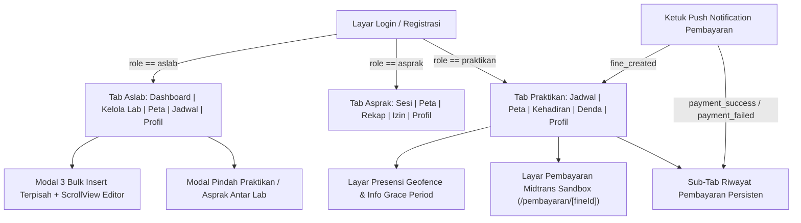

# Navigasi, Layar, dan Spesifikasi UI Multi-Peran — Sprint 4

Dokumen ini mendefinisikan struktur navigasi adaptif 3 peran (`praktikan`, `asprak`, `aslab`), spesifikasi layar baru Sprint 4, dan penyelarasan penuh terhadap sistem desain **"Soft Glass Pastel"** pada [ui-style-guide.md](../ui-style-guide.md) serta token `src/constants/theme.ts`.

---

## 1. Standar Visual Wajib ("Soft Glass Pastel")

Seluruh layar baru maupun layar yang diperbarui di Sprint 4 **wajib** mematuhi aturan presentasi berikut:

1. **Zero Hardcoded Styles**: Dilarang menulis warna hex/ukuran/font mentah di screen (`src/app/`, `src/features/`). Seluruh nilai wajib diambil dari `src/constants/theme.ts` (`Colors`, `Gradients`, `Spacing`, `Radius`, `FontSize`, `FontFamily`, `Shadow`) dan teks menggunakan `AppText` (font **Outfit** `Outfit_400Regular` / `500Medium` / `600SemiBold`).
2. **Aksen Tunggal Charcoal**: Aksi utama (CTA `Bayar Denda`, `Simpan Data`, tab aktif pada `FloatingPillTabBar`, `FilterChip` aktif) menggunakan `Colors.primary` (`#2B2E35`) berbentuk `Radius.pill`. Dilarang memakai warna jenuh/neon atau biru lama (`#1A56DB`).
3. **Pemetaan `ScreenContainer` & `AppCard` per Layar**:
   - Layar ringkasan/overview (`/(tabs)/dashboard`, `/(tabs)/denda`, `/(tabs)/kehadiran`, `/(tabs)/rekap`) menggunakan `ScreenContainer variant="gradient"` (`Gradients.screen`: `#C6DEEA → #D9E1F0 → #E9D3EA`) dengan kartu `AppCard variant="glass"` (`Colors.glass` + `BlurView`, `Radius.lg` = 28, `Shadow.card`).
   - Layar daftar padat (`/(tabs)/kelola-lab`, `/(tabs)/jadwal`) menggunakan `ScreenContainer variant="list"` (`Colors.listBackground`: `#F3F3F5`) dengan kartu `AppCard variant="solid"` (`Colors.surface`, `Radius.lg` = 28) atau kartu gradient (`Gradients.courseA/B/C`).
   - Modal & aksi geser (`BulkInsertModal`, `MemberTransferModal`, konfirmasi) menggunakan gaya **White Bottom Sheet** (`Colors.surface`, sudut atas `Radius.xl` = 32, handle `Colors.handle`, backdrop `Colors.backdrop`).
   - Layar transaksi/detail (`/pembayaran/[fineId]`) menggunakan pola header gradient (`Gradients.detailTop`) + sheet putih overlap + CTA pill charcoal melayang (`Shadow.floating`).
4. **Pemetaan Token Badge Status Baru (Soft Semantic)**:
   - `Tepat Waktu` / `Success` / `Lunas` / `Accept`: background `Colors.successSoft`, teks `Colors.success`.
   - `Terlambat` / `Pending` / `Menunggu Pembayaran` / `Kolom Kosong`: background `Colors.warningSoft`, teks `Colors.warning`.
   - `Failed` / `Belum Dibayar` / `Deny` / `Alfa`: background `Colors.dangerSoft`, teks `Colors.danger`.
   - `Izin (Excused Absence)` / `Ditutup` / `Diarsipkan`: background `Colors.neutralSoft` (atau `Colors.unreadSurface` dengan border `Colors.unreadBorder` agar berbeda visual dari alfa), teks `Colors.textMuted` / `Colors.accentBlue`.
5. **Ekstensi Ikon (`src/components/ui/AppIcon.tsx`)**:
   - Mempertahankan gaya **Feather outline** tipis (`size` 16–20). Tambahkan nama ikon baru ke union `AppIconName`: `'credit-card'` (Denda/Pembayaran), `'layers'` (Kelola Lab), `'upload'` & `'download'` (Bulk CSV), `'repeat'` (Transfer Anggota), `'sliders'` (Konfigurasi Kebijakan), `'check'` (Accept), dan `'alert-circle'` (Peringatan validasi).
6. **Layout, Safe Area, & Motion**:
   - Padding horizontal `20` (`Spacing.md + 4`), jarak antar kartu `12`, ruang bawah `paddingBottom: 104` (`ScreenContainer hasTabBar={true}`) agar tidak tertutup `FloatingPillTabBar`.
   - Touch target minimal `44×44` lengkap dengan `accessibilityRole` & `accessibilityLabel` Bahasa Indonesia.
   - Interaksi tekan kartu/tombol tetap ringan (`scale: 0.97`, `opacity: 0.9`, 120ms) dengan haptic opsional (`expo-haptics`).

---

## 2. Peta Navigasi Berdasarkan Peran Pengguna

Agar komponen `FloatingPillTabBar` (`src/app/(tabs)/_layout.tsx`) tetap proporsional, modern, dan tidak melebihi batas ergonomis 5 tab per peran, daftar tab diatur secara dinamis sebagai berikut:

| Urutan Tab | **Praktikan** | **Asprak** | **Aslab (Peran Baru)** |
| --- | --- | --- | --- |
| **Tab 1** | `Jadwal` (`/(tabs)/jadwal`) | `Sesi` (`/(tabs)/jadwal`) | `Dashboard` (`/(tabs)/dashboard`) |
| **Tab 2** | `Peta` (`/(tabs)/peta`) | `Peta` (`/(tabs)/peta`) | `Kelola Lab` (`/(tabs)/kelola-lab`) |
| **Tab 3** | `Kehadiran` (`/(tabs)/kehadiran`) | `Rekap` (`/(tabs)/rekap`) | `Peta` (`/(tabs)/peta`) |
| **Tab 4** | `Denda` (`/(tabs)/denda`) *( + akses Izin di header/sub-tab)* | `Izin` (`/(tabs)/izin`) | `Jadwal` (`/(tabs)/jadwal`) |
| **Tab 5** | `Profil` (`/(tabs)/profil`) | `Profil` (`/(tabs)/profil`) | `Profil` (`/(tabs)/profil`) |

> **Catatan Navigasi Praktikan**: Agar Praktikan tetap memiliki 5 tab bersih, fitur **Izin** tetap memiliki rute `/(tabs)/izin` (dapat diakses melalui segmented switch pada grup Kehadiran/Izin atau pintasan cepat di kartu Jadwal & Sesi), sementara **Denda & Pembayaran** mendapat eksposur langsung di `/(tabs)/denda` dan terhubung dengan deep link notifikasi.

---

## 3. Rincian Rute Expo Router Baru & Diperbarui

| Rute | File | Status | Akses Peran | Keterangan |
| --- | --- | --- | --- | --- |
| `/(tabs)/_layout.tsx` | `src/app/(tabs)/_layout.tsx` | Diperbarui | Semua | Konfigurasi `href` dinamis pada `FloatingPillTabBar` untuk 3 peran |
| `/(tabs)/dashboard` | `src/app/(tabs)/dashboard.tsx` | **Baru** | Aslab | Dashboard keberlangsungan lab & riwayat keuangan denda |
| `/(tabs)/kelola-lab` | `src/app/(tabs)/kelola-lab.tsx` | **Baru** | Aslab | Manajemen lab, radius, batas telat, 3 bulk insert, & pindah anggota |
| `/(tabs)/denda` | `src/app/(tabs)/denda.tsx` | **Baru** | Praktikan | Daftar tagihan denda aktif & tab riwayat pembayaran persisten |
| `/pembayaran/[fineId]` | `src/app/pembayaran/[fineId].tsx` | **Baru** | Praktikan | Layar transaksi Midtrans Sandbox (`WebView`) & pantauan verifikasi |
| `/(tabs)/jadwal` | `src/app/(tabs)/jadwal.tsx` | Diperbarui | Semua | Asprak hanya melihat sesi kelasnya; Praktikan melihat info izin/denda |
| `/(tabs)/peta` | `src/app/(tabs)/peta.tsx` | Diperbarui | Semua | Tombol `"Kelola lab"` hanya muncul untuk `aslab` (disembunyikan dari `asprak`) |
| `/(tabs)/kehadiran` | `src/app/(tabs)/kehadiran.tsx` | Diperbarui | Praktikan | Menampilkan badge `Hadir (Tepat Waktu)`, `Hadir (Terlambat)`, dan `Izin (Excused)` |
| `/presensi/[sesiId]` | `src/app/presensi/[sesiId].tsx` | Diperbarui | Praktikan | Menampilkan countdown/informasi batas *grace period* sesi |

---

## 4. Spesifikasi Layar Baru Sprint 4

### A. Layar Manajemen Laboratorium & Bulk Insert (`/(tabs)/kelola-lab` — Khusus Aslab)

*Base UI*: `ScreenContainer variant="list"` (`#F3F3F5`) · Kartu `AppCard variant="solid"` (`Radius.lg` = 28) · Modal bergaya **White Bottom Sheet** (`Radius.xl` = 32 di sudut atas + handle `Colors.handle`).

1. **Pemilih Mata Kuliah Tanggung Jawab**:
   - Header profil Aslab + deretan `FilterChip` horizontal (aktif = `Colors.primary` charcoal, teks putih) untuk memilih mata kuliah tanggung jawab.
2. **Panel Aksi Cepat (3 Bulk Insert Terpisah + Single Insert)**:
   - Tiga kartu/tombol terpisah secara eksplisit dengan ikon Feather outline (`layers`, `users`, `user`):
     1. **Kelola / Bulk Laboratorium** (berdasarkan mata kuliah terpilih).
     2. **Kelola / Bulk Praktikan** (memilih 1 laboratorium tujuan terlebih dahulu).
     3. **Kelola / Bulk Asprak** (memilih 1 laboratorium tujuan terlebih dahulu).
   - Tombol secondary pill **"Pindahkan Praktikan / Asprak"** (ikon `repeat`) untuk memindahkan anggota dari Lab A ke Lab B tanpa mengubah jadwal.
3. **Modal Bulk Insert & Editor `ScrollView` Fleksibel**:
   - **Langkah 1 (Template & Upload)**: Tombol secondary pill *"Unduh Template CSV"* (ikon `download`) dan tombol primary charcoal *"Pilih File CSV"* (ikon `upload`).
   - **Langkah 2 (Interactive `ScrollView` List)**:
     - Header ringkasan dalam pill lembut: *"18 diterima · 2 ditolak · 3 perlu dilengkapi"*.
     - Daftar kartu baris (`AppCard variant="solid"`, `Radius.md` = 20) di dalam `ScrollView`:
       - Chip toggle **Accept** (`Colors.successSoft`/`Colors.success`) vs **Deny** (`Colors.dangerSoft`/`Colors.danger`) pada tiap baris.
       - Kolom `FormField` (`Radius.md` = 20) untuk mengubah nilai atau mengisi kolom yang masih kosong (ditandai `InfoBanner tone="warning"` / border `Colors.warning` jika wajib tetapi masih kosong).
     - Tombol utama pill charcoal melayang di footer (`Shadow.floating`): *"Simpan X Data yang Diterima"*.
4. **Form Konfigurasi Kebijakan Lab**:
   - Input `FormField` untuk Nama Lab, Kode, Lokasi/Gedung, Koordinat (peta Leaflet interaktif), **Cakupan Radius Presensi (`radiusMeters`)**, **Batas Toleransi Keterlambatan (`gracePeriodMinutes`)**, dan **Nominal Tetap Denda (`Rp`)**.

---

### B. Layar Dashboard Keberlangsungan & Keuangan Lab (`/(tabs)/dashboard` — Khusus Aslab)

*Base UI*: `ScreenContainer variant="gradient"` (`Gradients.screen`) · Kartu ringkasan `AppCard variant="glass"` + `StatTile` 2 kolom (`gap: 12`) · `ProgressBar` fill `Colors.accentPink`.

1. **Header & Bar Filter Periode Waktu**:
   - Header profil Aslab (avatar lingkaran charcoal + nama + pill peran `Aslab` + `NotificationBell`).
   - Segmented `FilterChip`: **Hari Ini**, **Minggu Ini**, **Bulan Ini** (dilengkapi `IconButton` navigasi periode sebelumnya/berikutnya).
2. **Kartu Metrik Utama (`StatTile` Grid 2 Kolom)**:
   - Total Laboratorium Aktif & Total Praktikan Terdaftar (angka besar `FontSize.stat` weight 500 Outfit).
   - Sesi Aktif / Terlaksana pada periode terpilih.
   - Kartu Glass Ringkasan Kas Denda: **Total Terkumpul (Lunas)** (`Colors.success`) & **Total Tertunggak (Belum Lunas)** (`Colors.warning`), disertai `ProgressBar` rasio pelunasan.
3. **Seksi Status Setiap Laboratorium**:
   - Kartu `AppCard variant="glass"` per laboratorium menampilkan nama lab, gedung/lokasi, jumlah praktikan & asprak, serta pill status soft (*Sedang Praktikum* = `successSoft` / *Terjadwal* = `warningSoft` / *Kosong* = `neutralSoft`).
4. **Seksi Jadwal Berlangsung & Akan Datang**:
   - Daftar `SessionCard` (gradient `courseA/B/C`) dengan sesi `open` di urutan teratas, diikuti jadwal praktikum yang akan datang beserta waktu pelaksanaan & ruangan.
5. **Seksi Riwayat Kegiatan & Riwayat Keuangan Denda**:
   - `FilterChip` lokal untuk berpindah antara **Riwayat Sesi Selesai** (tingkat kehadiran & jumlah terlambat) dan **Riwayat Keuangan Denda** (nama praktikan, lab, sesi, nominal `Rp`, waktu bayar, badge soft `Success`/`Pending`/`Unpaid`).

---

### C. Layar Tagihan Denda & Riwayat Pembayaran (`/(tabs)/denda` — Khusus Praktikan)

*Base UI*: `ScreenContainer variant="gradient"` (`Gradients.screen`) · Kartu `AppCard variant="glass"` · `FilterChip` segmented untuk berpindah antar sub-tab.

1. **Sub-tab 1: Tagihan Aktif**:
   - Kartu `AppCard variant="glass"` ringkasan total tunggakan denda aktif (`FontSize.stat` Outfit).
   - Daftar kartu tagihan (`fines`):
     - Nama praktikum & topik sesi, nama lab, tanggal sesi.
     - Keterangan keterlambatan: *"Presensi pukul 10.19 WIB (Melewati toleransi 15 menit — Terlambat 4 menit)"*.
     - Nominal denda tetap (misal: `Rp10.000`) dan badge soft (`Colors.dangerSoft` untuk *Belum Dibayar* / `Colors.warningSoft` untuk *Menunggu Pembayaran*).
     - Tombol primary pill charcoal **"Bayar Denda"** (mengarahkan ke `/pembayaran/[fineId]`).
2. **Sub-tab 2: Riwayat Pembayaran (Persisten)**:
   - Menampilkan seluruh riwayat transaksi pembayaran praktikan dari koleksi `payments` di Firestore dalam kartu `AppCard variant="glass"`:
     - Informasi topik/nama sesi & laboratorium.
     - Tanggal tagihan dibuat & waktu transaksi dilakukan.
     - Nominal pembayaran (`Rp`) dan metode pembayaran.
     - Badge status soft: **`Pending`** (`warningSoft`/`warning`), **`Success`** (`successSoft`/`success`), atau **`Failed`** (`dangerSoft`/`danger`, disertai tombol secondary pill *"Coba Bayar Lagi"* jika tagihan induk belum lunas).

---

### D. Layar Checkout Pembayaran Midtrans (`/pembayaran/[fineId]`)

*Base UI*: Header `LinearGradient` (`Gradients.detailTop`) dengan `IconButton` back lingkaran putih + judul + **White Sheet** (`Radius.xl` sudut atas) dan CTA pill charcoal melayang (`Shadow.floating`).

1. **State Memuat Transaksi**: Menampilkan ringkasan tagihan pada sheet putih sembari memanggil backend `POST /api/payments/create`.
2. **Mode Snap WebView**: Memuat `redirectUrl` Midtrans Sandbox di dalam `react-native-webview` dengan header navigasi `IconButton` back yang aman.
3. **State Verifikasi Server**: Saat pengguna menyelesaikan langkah di halaman Snap Midtrans, layar menampilkan `AppCard variant="glass"` / sheet status real-time (*"Menunggu konfirmasi pembayaran dari Midtrans..."*) yang berlangganan `onSnapshot` ke dokumen `fines/{fineId}` dan `payments/{orderId}`. Begitu webhook backend masuk, tampilan otomatis berubah menjadi status `Success` (`Colors.successSoft`) atau `Failed` (`Colors.dangerSoft`).

---

## 5. Penanganan Kondisi Error & Edge Cases UI Baru

| Kondisi | Penanganan Tampilan (UI State) | Aksi Pemulihan untuk Pengguna |
| --- | --- | --- |
| **File CSV salah format / kosong** | `InfoBanner` merah di modal Bulk Insert: *"Format kolom CSV tidak sesuai template."* | Tombol *"Unduh Template Resmi"* tepat di bawah pesan error. |
| **Baris Bulk masih ada kolom kosong** | Kartu baris diberi highlight kuning *"2 kolom wajib belum diisi"*; tombol Simpan menahan baris tersebut. | Aslab langsung mengetik nilai yang kurang di dalam `ScrollView` atau mengubah baris menjadi *Deny*. |
| **Praktikan menutup WebView sebelum bayar** | Status transaksi tetap `Pending` dengan instruksi penyelesaian pembayaran. | Tombol *"Lanjutkan Pembayaran"* (membuka kembali `redirectUrl` aktif) atau *"Buat Transaksi Baru"* jika sudah kedaluwarsa. |
| **Webhook Midtrans belum tiba (jaringan lambat)** | Indikator pemantauan real-time: *"Pembayaran sedang diverifikasi oleh server..."* | Listener Firestore otomatis memperbarui layar saat webhook diproses backend + tombol *"Cek Status"*. |
| **Backend tidak terjangkau** | `InfoBanner` peringatan: *"Layanan pembayaran sedang tidak dapat dihubungi."* | Tombol *"Coba Lagi"* tanpa mengubah status tagihan lokal. |
